# Chrono Mail

Chrono Mail is a free e-mail program for your computer. It keeps your mail, your calendar, your contacts and your tasks together in one window.

It works with the mail account you already have: the address and password your provider gave you are all it needs. Your mail is stored safely on your computer, locked so that only you can read it, and Chrono Mail stays quick even with hundreds of thousands of messages.

Chrono Mail is made for Linux first, and it also runs on Windows. The program is in English; dates and times follow the language of your computer.

<picture>
  <source media="(prefers-color-scheme: dark)" srcset="docs/images/main-mail-dark.png">
  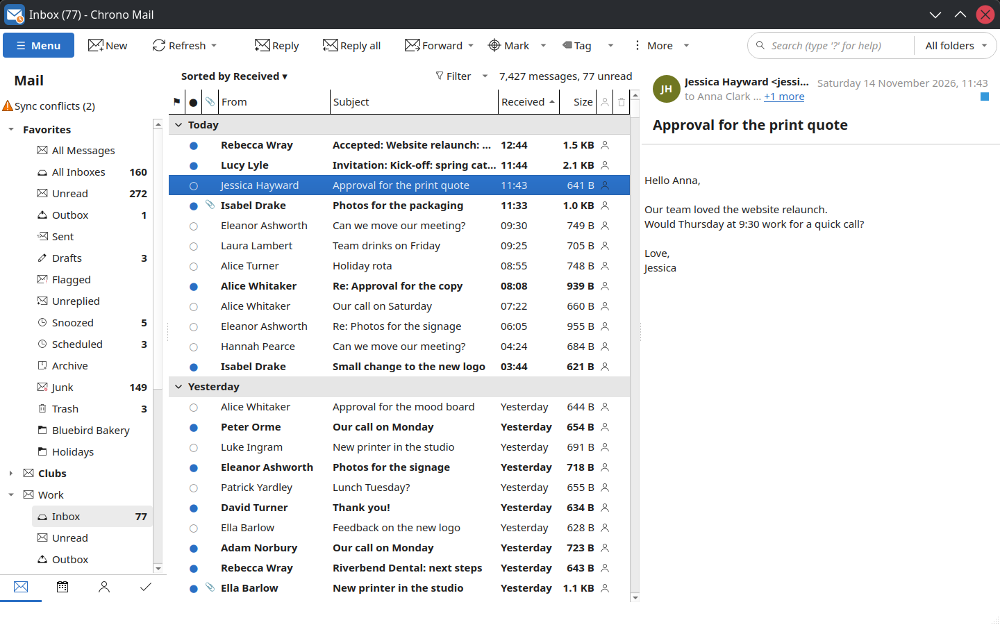
</picture>

## What you can do with it

1. Read, write and send e-mail from one or more accounts: POP3, IMAP and Gmail.
2. Keep your calendar, contacts and tasks next to your mail, in step with your provider's server, Google Calendar and Google Contacts included.
3. Keep your mail in order with folders, Favorites, tags, the archive, snooze and rules.
4. Let the junk filter put spam aside for you.
5. Find any message quickly with the search field, or build a detailed search and save it.
6. Send a message later, or again and again on a schedule, and take back a message in the first seconds after you sent it.
7. Answer meeting invitations from the mail itself, and invite others to your own meetings.
8. Undo what you did to your mail with Ctrl+Z.
9. Keep working without an internet connection: what you do is sent as soon as you are back online.
10. Make a backup of everything, and bring it back on this computer or another one.
11. Bring your mail, contacts and calendar over from another mail program.

## Contents

1. [Install](#install)
2. [Updating](#updating)
3. [Uninstall](#uninstall) and [Your mail stays](#your-mail-stays)
4. [The first start](#the-first-start)
5. [Finding your way around](#finding-your-way-around)
6. [Accounts](#accounts)
7. [Mail](#mail)
   1. [The folder list](#the-folder-list)
   2. [The message list](#the-message-list)
   3. [Reading a message](#reading-a-message)
   4. [Writing a message](#writing-a-message)
   5. [Sending, sending later and the Outbox](#sending-sending-later-and-the-outbox)
   6. [Keeping your mail in order](#keeping-your-mail-in-order)
   7. [Junk mail](#junk-mail)
   8. [Tags on mail](#tags-on-mail)
   9. [Rules](#rules)
   10. [Finding mail](#finding-mail)
   11. [Undo and Redo](#undo-and-redo)
   12. [Refresh and the Operations window](#refresh-and-the-operations-window)
8. [Calendar](#calendar)
9. [Invitations and meetings](#invitations-and-meetings)
10. [Contacts](#contacts)
11. [Tasks](#tasks)
12. [Tags](#tags)
13. [Working offline and staying in step](#working-offline-and-staying-in-step)
14. [Import and export](#import-and-export)
15. [Backup and restore](#backup-and-restore)
16. [Security and privacy](#security-and-privacy)
17. [Settings](#settings)
18. [Keyboard shortcuts](#keyboard-shortcuts)
19. [Questions and problems](#questions-and-problems)
20. [Help and feedback](#help-and-feedback)
21. [For developers](#for-developers)
22. [License](#license)

## Install

### Linux, the easy way

1. Open the [download page](https://github.com/rob-vandenberg/chrono-mail/releases/latest).
2. Download the file for your computer:
   1. Ubuntu, Kubuntu, Linux Mint, Debian: the file that ends in **_amd64.deb**.
   2. Fedora, openSUSE: the file that ends in **_x86_64.rpm**.
3. Double-click the downloaded file. Your software centre opens (Discover on KDE, Software on GNOME).
4. Click **Install**, and type your computer password when asked.

That is all. Chrono Mail is now in your applications menu.

If double-clicking the file does not open a software centre, use the terminal way below.

The packages run on Ubuntu 22.04 and newer, Debian 12 and newer, Linux Mint 21 and newer, and Fedora 36 and newer. Everything Chrono Mail needs comes inside the package; nothing else has to be installed.

### Linux, if you prefer the terminal

Open a terminal in the folder where the file was downloaded, and type the line for your system.

Ubuntu, Kubuntu, Linux Mint, Debian:

```bash
sudo apt install ./chrono-mail_*_amd64.deb
```

Fedora:

```bash
sudo dnf install ./chrono-mail_*_x86_64.rpm
```

openSUSE:

```bash
sudo zypper install ./chrono-mail_*_x86_64.rpm
```

If the folder holds more than one Chrono Mail file, type the full name of the newest one instead of the `*`.

### Windows

1. Open the [download page](https://github.com/rob-vandenberg/chrono-mail/releases/latest).
2. Download the file that ends in **_x64_setup.exe**.
3. Double-click it and follow the steps. You can install Chrono Mail for everyone on the computer, or only for yourself.

The setup makes an entry in the Start menu (and a desktop icon, if you tick it), and an uninstaller under **Settings > Apps**.

### Calendar files

Once installed, Chrono Mail is offered as a program to open calendar files (files ending in **.ics**) with: right-click such a file and choose **Open with**. Chrono Mail never makes itself the standard program for these files on its own. See [Calendar files](#calendar-files-1).

## Updating

### From inside Chrono Mail

An installed Chrono Mail can update itself.

1. When **Automatically check for updates** is ticked (in **Settings > General**, ticked at the start), Chrono Mail looks for a newer version on GitHub, at most once a day, and only together with a Refresh that reaches out to your mail servers anyway. It never goes on the internet just for this.
2. You can also look yourself: **Menu > Help > About Chrono Mail**, then **Check for updates**.
3. When a newer version is there, the window **Update available** says which version it is and links to what is new. Choose **Download**, **Skip** (nothing is offered again until an even newer version comes) or **Cancel**.
4. After the download, Chrono Mail checks that the file is complete and unchanged. The window **Update downloaded** then offers **Install**, or **Close** to install it yourself later from the folder it names.
5. On Linux, your system asks for its password, the update is installed, and Chrono Mail offers **Restart Chrono Mail** or **Close Chrono Mail**.
6. On Windows, Chrono Mail closes, the setup runs, and Chrono Mail opens again when it is done.

### By hand

Download the newer file and install it the same way as the first time. Your mail and settings stay as they are.

## Uninstall

### Linux, the easy way

1. Open your software centre (Discover on KDE, Software on GNOME).
2. Go to **Installed**.
3. Find **Chrono Mail** and click **Uninstall**.

### Linux, if you prefer the terminal

Ubuntu, Kubuntu, Linux Mint, Debian:

```bash
sudo apt remove chrono-mail
```

Fedora:

```bash
sudo dnf remove chrono-mail
```

openSUSE:

```bash
sudo zypper remove chrono-mail
```

### Windows

Open **Settings > Apps**, find **Chrono Mail** and choose **Uninstall**.

### Your mail stays

Uninstalling removes the program only. Your mail, your settings and the key that unlocks your mail stay on your computer, so if you install Chrono Mail again later, everything is there as you left it.

On Linux, your mail and settings are in these two folders in your home folder (they are hidden; press Ctrl+H in the file manager to see them):

1. `.local/share/chrono-mail`: your mail, calendars, contacts and tasks.
2. `.config/chrono-mail`: your settings.

On Windows, both are in the folder `AppData\Local\chrono-mail` in your user folder.

You can also see where your mail is kept in **Settings > Security and storage**, under **Your mail is stored encrypted in:**.

If you want to remove everything, delete those folders. Mail that exists only on this computer is then gone for good, so only do this when you are sure you no longer need it, or after making a [backup](#backup-and-restore).

## The first start

Open your applications menu (or the Start menu on Windows) and choose **Chrono Mail**.

### Your first account

At the first start, Chrono Mail welcomes you with the window **Add an account**. It also offers **Restore a backup…**, if you are moving to this computer from another one (see [Backup and restore](#backup-and-restore)).

To add your first account:

1. Choose the **Account type** at the top. For most people this is **IMAP** or **POP3**; for a Gmail address it is **Gmail**. See [Kinds of account](#kinds-of-account) if you are not sure.
2. Fill in the **Account** tab: **Shown as** (a name only you see, such as "Work"; you can leave it empty), **Your name** (the name people see when you write to them), **E-mail address**, and the sign-in name and password your provider gave you.
3. As soon as you type your address, Chrono Mail fills in a first guess for the servers on the **Servers** tab. Often that guess is right; if not, change it with the details from your provider's help pages.
4. Look at the **Options** tab. The safe choices are already made.
5. Click **Test connection**. Chrono Mail tries to reach both servers and says how it went.
6. Click **Add account**.

If a box is missing, a red line says what is missing, and the tab with the empty box comes to the front.

<picture>
  <source media="(prefers-color-scheme: dark)" srcset="docs/images/add-account-dark.png">
  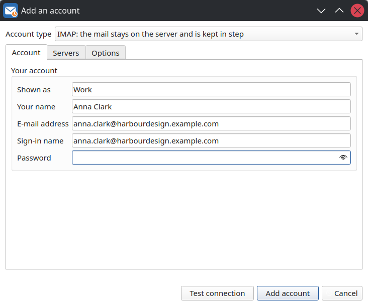
</picture>

### Your calendars and contacts

After adding the account, Chrono Mail looks on your provider's server for calendars, contacts and task lists that belong to it. When it finds them, the window **Additional folders found** lists them with a tick each: **Select the folders you would like to add:**. Tick the ones you want, and click **OK**. Chrono Mail then keeps them in step with your provider.

If your provider has no calendars or contacts, nothing appears, and you can simply carry on.

### Your recovery code

Next comes the window **Your recovery code**.

<picture>
  <source media="(prefers-color-scheme: dark)" srcset="docs/images/recovery-code-dark.png">
  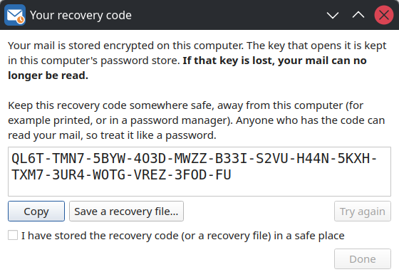
</picture>

1. Click **Copy** and keep the code in your password manager, or write it down and keep it somewhere safe, away from this computer.
2. Or click **Save a recovery file…** to keep it as a file, protected by a passphrase you choose. Keep that file somewhere else than on this computer, such as a USB stick, and keep the passphrase apart from the file.
3. Tick **I have stored the recovery code (or a recovery file) in a safe place**, and click **Done**.

If you close the window without the tick, Chrono Mail asks whether you are sure, and it shows the code again at the next start until you have confirmed that it is stored.

### Why the recovery code matters

Chrono Mail locks your stored mail with a key, and keeps that key in your computer's password store (on KDE: KDE Wallet; on GNOME: Passwords and Keys; on Windows: the Credential Manager). If that password store is ever lost, for example after reinstalling your computer, the recovery code (or the recovery file with its passphrase) is the only way to unlock your mail again.

Treat the recovery code like a password: anyone who has it can unlock your mail.

You can see the recovery code again at any time: **Menu > File > Show the recovery code…**, or **Settings > Security and storage > Show the recovery code…**.

## Finding your way around

### The four sections

Chrono Mail has four sections: **Mail**, **Calendar**, **Contacts** and **Tasks**. Switch between them with the square buttons at the bottom left of the window, with **Menu > View**, or with the keys Ctrl+1, Ctrl+2, Ctrl+3 and Ctrl+4. Chrono Mail remembers the section you used last.

Each section has its own sidebar on the left, its own main area and its own row of buttons at the top.

### The toolbar

Across the top is one row of buttons for the section on screen. In Mail it holds, from left to right:

1. **Menu**, which holds everything else (see below).
2. **New** and **Refresh**. The small arrow next to Refresh opens its menu (see [Refresh](#refresh-and-the-operations-window)).
3. **Reply**, **Reply all** and **Forward**. The arrow next to Forward offers **Forward as attachment**.
4. **Mark**, with **Mark as read**, **Mark as unread**, **Flag** and **Remove flag**.
5. **Tag**, **Archive**, **Snooze**, **Move to** and **Delete**.
6. The search field.

When the window is narrow, the buttons on the right fold into **More**, so nothing is ever out of reach. Menu always stays.

Calendar, Contacts and Tasks have their own buttons, such as **New event**, **New contact** or **New task**, **Refresh**, **Edit** and **Delete**, and a search field.

### The Menu

**Menu**, at the top left (or Alt+M), holds:

1. **Settings…**, **Accounts…**, **Rules…**, **Tags…** and **Sync conflicts…**.
2. **File**: **New**, **Refresh**, **Backup…**, **Restore…**, **Import…**, **Export…**, **Show the recovery code…** and **Use a recovery code…**.
3. **Message**: **Undo**, **Redo**, **Open**, **Edit draft**, the reply buttons, the marks, **Move to folder…**, **Quick move**, **Copy to folder…**, **Quick copy**, **Archive**, **Snooze…**, **Move to Junk**, **Delete**, **Delete permanently…**, **Go to** (next and previous message, next and previous unread message, **Go to folder…**), **Save as…**, **Print…** and **View source**.
4. **Folder**: **New folder…**, **Rename folder…**, **Delete folder…**, **Mark all as read**, **Empty folder…** and **Apply to all folders**.
5. **View**: the four sections, **Search**, **Folder list**, **Message list** (Columns or Cards), **Reading pane** (At the right, At the bottom, Off), **Advanced search…**, **Show conversations**, **Show groups**, **Refresh automatically** and **Operations…**.
6. **Help**: **About Chrono Mail**.
7. **Exit**.

Every item that has a key shows it in the menu. Greyed items are not usable at that moment, for example Reply when no message is selected.

### The status line and the busy bar

At the bottom of the window, the status line says what just happened ("Mail checked: 3 new messages", "Sent 1 message from the Outbox"), and the busy bar moves while something runs. Hover over the busy bar to see what it is doing.

### Sizes

**Settings > Appearance > Sizes** has four sliders, each from small to large, and a **Reset** button for each:

1. **Main window**: the text and buttons of the main window.
2. **Message list**: the text of the message list.
3. **Other windows and dialogs**: every other window, such as Settings and the message window.
4. **Text of messages**: the text of the messages you read.

You see each change at once. **Cancel** puts everything back as it was.

### Light and dark, and the accent colour

**Settings > Appearance > Colours** offers **Follow the system**, **Light** and **Dark**. Follow the system takes the light or the dark colours as your computer is set. Messages in HTML are always shown on a white page, because they are written for one.

**Accent colour** is the colour of the selection, the buttons such as Send and the links. Click **Sample** to pick another colour; **Reset** brings back the standard blue. The light and the dark look each keep their own accent colour.

### The notification area

When **Show an icon in the notification area** is ticked (in **Settings > General**), Chrono Mail shows an icon there with the number of unread messages. A click shows or hides the window. Its right-click menu starts with the name and version of Chrono Mail, and offers **Show or hide Chrono Mail**, **Refresh**, **Settings…** and **Quit**.

With **Closing the window keeps Chrono Mail running in the notification area** ticked, closing the window keeps Chrono Mail running, so that new mail and reminders still arrive. **Menu > Exit** and **Quit** always end the program.

### One Chrono Mail at a time

If you start Chrono Mail while it is already running, the window that is already open comes to the front. You never have two copies working on the same mail.

## Accounts

**Menu > Accounts…** (or **Settings > Accounts**) lists your accounts, each on two lines: the name it is shown as with its address, and below it what it holds, such as "Mail (POP3)", "Google Calendar" or "Calendars and contacts". Here you can **Add…**, **Edit…** and **Remove…** accounts.

You can also add an account from the sidebar of Calendar, Contacts or Tasks: right-click and choose **Add account…**.

### Kinds of account

The **Account type** at the top of **Add an account** offers:

1. **POP3: the mail is downloaded to this computer.** Your mail is fetched from the server and kept here. Choose this if you read your mail only on this computer.
2. **IMAP: the mail stays on the server and is kept in step.** Your mail stays with your provider, and Chrono Mail keeps a copy in step: what you read, move or delete here, you see everywhere, on your phone, on your provider's website and on another computer. Not sure? Choose IMAP.
3. **Gmail: Google mail, with an app password.** See [Gmail](#gmail).
4. **Google Calendar and Contacts: sign in with Google.** See [Google Calendar and Google Contacts](#google-calendar-and-google-contacts).
5. **CalDAV: calendars and tasks from a server**, and **CardDAV: contacts from a server.** See [Calendars and contacts accounts](#calendars-and-contacts-accounts).

### The names of an account

1. **Shown as**: the name Chrono Mail shows for this account; only you see it. Leave it empty to see your address instead.
2. **Your name**: goes out with your mail, before your e-mail address.
3. **E-mail address**: your full address, such as anna.clark@example.org.
4. **Sign-in name**: what you sign in to the server with. This is often your e-mail address.

If two accounts would look the same in the lists, Chrono Mail adds what tells them apart, such as the sign-in name and the kind of account.

### The servers

The **Servers** tab has a box for **Incoming mail** and one for **Outgoing mail (SMTP)**, each with:

1. **Server**: the name of your provider's mail server, such as mail.example.org.
2. **Security**: keep the choice your provider gives.
   1. **TLS (encrypted from the start)** and **STARTTLS (upgrade to encrypted)** are the usual ones.
   2. **TLS, certificate not checked (weak)** is only for a server you know and trust whose certificate cannot be checked. Chrono Mail never chooses it for you.
   3. **None (not encrypted)**: never choose this unless your provider says so.
3. **Port**: Chrono Mail fills in the usual number for the security you chose, so you rarely need to change it.
4. **Sign-in name** and **Password**.

The outgoing box has **Use the same sign-in name and password as for incoming mail**, ticked at the start. Untick it only if your provider gave you a separate sign-in for sending.

Every password box has an eye at its right end: click it to see what you typed, click again to hide it.

### Options for POP3 accounts

The **Options** tab of a new POP3 account has:

1. **Server copies**: what happens to your mail on the server after Chrono Mail has downloaded it:
   1. **Leave all mail on the server (default)**: the safe choice.
   2. **Delete from the server once downloaded and verified**: only after Chrono Mail has stored the message and checked that it can read it back.
   3. **Delete from the server 30 days after download**.
   4. **Delete from the server when I delete it here**.
2. **Keep the mail in**: **A mailbox of its own, with its own folders**, or **Local Folders, together with the other accounts that keep their mail there**. You can change this later; the mail is then moved, and nothing is deleted before the copy has been checked.
3. **Encrypt the stored mail on this computer (recommended)**: leave this ticked. Your mail on this computer is then locked, so that only you can read it.

### Gmail

Google does not let mail programs use your normal Google password. Gmail needs an **app password** instead:

1. Turn on 2-Step Verification in your Google account.
2. Make an app password at [myaccount.google.com/apppasswords](https://myaccount.google.com/apppasswords). Google shows 16 letters.
3. In **Add an account**, choose **Gmail: Google mail, with an app password**.
4. Fill in the **Account** tab, and type the 16 letters under **App password**. Spaces you copy along are left out by themselves.
5. Click **Add account**.

Gmail's servers are filled in for you, so the **Servers** and **Options** tabs are greyed. A few things work in the Gmail way:

1. Gmail's **All Mail** holds every message once more, so it starts hidden. To see it, tick it in **Edit account > Folders**.
2. **Delete** moves a message to Gmail's Trash, and **Archive** moves it to a folder named Archive (a label in Gmail), so that Undo keeps working.
3. If Gmail refuses the password, Chrono Mail tells you what an app password is and where to make one.

<picture>
  <source media="(prefers-color-scheme: dark)" srcset="docs/images/add-account-gmail-dark.png">
  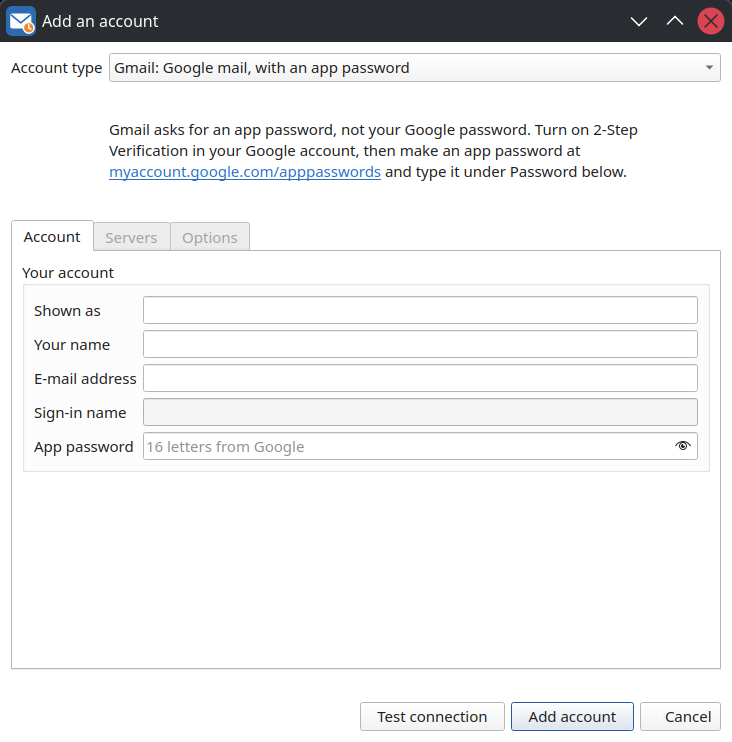
</picture>

### Google Calendar and Google Contacts

Your Google calendars and contacts use Google's own sign-in instead of a password:

1. In **Add an account**, choose **Google Calendar and Contacts: sign in with Google**.
2. Click **Sign in with Google**. Your web browser opens Google's sign-in page.
3. Sign in, and allow access to your calendars and contacts.
4. They are added as **Google Calendar** and **Google Contacts**, and appear in the Calendar and Contacts sections.

Chrono Mail only asks Google for your calendars, your contacts, your address and your name; never for your mail. For your Gmail mail, add a **Gmail** account as well.

Calendars that other people share with you on Google come along too. Google's task lists are not part of this account.

If Google ever ends the sign-in, open **Settings > Accounts**, choose the Google account, click **Edit…**, and click **Sign in with Google** on the **Calendars and contacts** tab.

A few things work in the Google way:

1. The colours you give appointments in Google Calendar become [tags](#tags) here, shown with the calendar's name, such as "Tomato (Family)".
2. Renaming a Google calendar here (right-click it in the Calendar sidebar, **Rename…**) gives it a name only for you. Other people who see that calendar keep its own name. An empty name brings Google's name back.

### Calendars and contacts accounts

If your calendars and contacts are on a CalDAV or CardDAV server, choose **CalDAV: calendars and tasks from a server** or **CardDAV: contacts from a server** in **Add an account**:

1. **Link to**: the mail account these calendars and contacts belong to (it then uses the same server and sign-in), or **No mail account (a separate account)**.
2. **Shown as**, **Server address** (a host name is enough), **Sign-in name** and **Password**.
3. Click **Find calendars, contacts and tasks**, tick what you want, and add the account.

A separate account of this kind holds no mail and takes no part in anything about mail.

### Changing an account

Choose an account in **Settings > Accounts** and click **Edit…**. The window has these tabs:

1. **General**: **Shown as**, **Your name**, **E-mail address**, the **Signature** (added at the end of new messages, replies and forwards), and:
   1. **Include this account in Send and Receive**: unticked, the account takes no part in Refresh, Automatic refresh or new-mail notices; it is refreshed only when you choose it in the Refresh button's menu. What you send from it by hand still goes.
   2. **Filter junk mail**: see [Junk mail](#junk-mail).
   3. For POP3: **Keep the mail in** and **Mail on the server**.
2. **Servers**: the incoming and outgoing servers, **Test connection**, and **Forget the accepted certificates**. A password box left empty keeps the stored password.
3. **Calendars and contacts**: the **Server address**, **Sign-in name** and **New password** of the calendar server, the **Folders** found there with a tick each, **Find calendars, contacts and tasks**, and who sends two kinds of mail:
   1. **Send reminder emails via**: Chrono Mail or the server. Unticked, no reminder e-mails are sent. If you use Chrono Mail on two computers, you can let only one of them send.
   2. **Send confirmation emails via**: who mails your answers to invitations, Chrono Mail or the server. Unticked, no answers are mailed. When Chrono Mail knows that only one of the two can send them, the choice is greyed with an (i) that says why.
4. **Folders** (IMAP): every folder on the server with a tick under **Synchronise**, and **Used as** to tell Chrono Mail which folder is the Sent, Drafts, Trash, Junk or Archive folder when it cannot tell by itself.

Click **Save** to keep the changes.

<picture>
  <source media="(prefers-color-scheme: dark)" srcset="docs/images/edit-account-dark.png">
  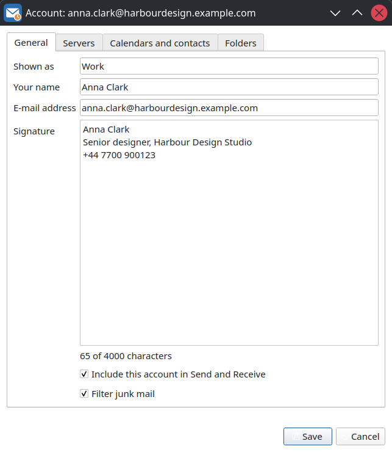
</picture>

The ticks on the Folders tab are this computer's view only. Unticking a folder hides it here; nothing changes on the server, and your other computers and your phone keep showing it.

### Removing an account

Choose the account in **Settings > Accounts** and click **Remove…**. Chrono Mail forgets the account and its passwords. The mail stored on this computer is not deleted, and nothing is removed from the server.

### Local Folders

**Local Folders** is the part of Chrono Mail that lives only on this computer. It holds:

1. The mail of POP3 accounts that keep their mail there.
2. Folders you make there yourself.
3. This computer's own calendar, task list and address book, which are made the first time you open Calendar, Tasks or Contacts.

Local Folders can never be removed, because it holds your own data. You can hide it in **Settings > Sidebar**.

### Passwords

Your passwords are kept in your computer's password store, never in a plain file. Once a password is stored, Chrono Mail never asks for it again: testing a connection or checking mail takes it from the store. On Linux, every entry of Chrono Mail in the password store (KDE Wallet, GNOME Keyring) has a name you can read, such as "Chrono Mail: Work, anna.clark@example.org (incoming mail server)"; in the Windows Credential Manager that readable name is in each entry's User name.

### Certificates

A mail server shows a certificate to prove who it is. When Chrono Mail cannot confirm it, the window **Verify certificate** opens at once and asks whether to connect anyway. It shows one server at a time, and each server once.

1. **Connect** trusts exactly this certificate until Chrono Mail closes. Tick **Don't ask me again** to trust it for good.
2. **Do not connect** stops.
3. **Show certificate** shows who the certificate was issued to and by whom.

Only connect when you know the server belongs to you or your provider (for example, your own company's server). If you are not sure, choose **Do not connect** and ask your provider.

If the certificate of a server you accepted changes later, Chrono Mail asks again. A renewal that the usual checks accept goes without a question. **Edit account > Servers > Forget the accepted certificates** forgets every certificate you accepted for that account.

## Mail

### The folder list

The folder list on the left of Mail shows, from top to bottom:

1. **Favorites**: views that gather mail from all your accounts:
   1. **All Messages**: every message in every folder of every account.
   2. **All Inboxes**: the Inboxes of all your accounts together.
   3. **Unread**, **Outbox**, **Sent**, **Drafts**, **Flagged**, **Unreplied**, **Snoozed**, **Scheduled**, **Archive**, **Junk** and **Trash**, each from all accounts together. Snoozed, Scheduled and Archive appear once some account has them.
   4. The folders you pinned to Favorites.
2. Your accounts and groups of accounts, each with its folders. The standard folders (Inbox, Outbox, Sent, Drafts, Snoozed, Scheduled, Archive, Junk, Trash) come first, then your own folders by name.
3. **Local Folders**, last.

Below the folder list is the **Tags** block; see [Tags on mail](#tags-on-mail).

The number at the right of a folder is the number of unread messages in it. For Drafts, Outbox, Scheduled and Snoozed it is the number of messages they hold.

Things you can do in the folder list:

1. Right-click a folder for **New folder…**, **Rename folder…**, **Delete folder…**, **Mark all as read**, **Empty folder…** (Trash and Junk only) and **Add to Favorites**.
2. Right-click anywhere in Favorites to show or hide each Favorites entry with a tick. A pinned folder offers **Remove from Favorites**, **Rename…**, **Move up** and **Move down**.
3. Right-click an account and choose **Put in group** to gather accounts in a group of their own, with its own All Inboxes. **New group…** makes a group; a group offers **Rename group…** and **Remove group**; an account in a group offers **Take out of its group**.
4. Drag messages onto a folder to move them there.
5. Press F9, or **Menu > View > Folder list**, to hide or show the folder list with its Tags block.

New folder and Rename folder ask only for the name. A new folder is made inside the folder you right-clicked. The standard folders (Inbox, Sent, Drafts, Trash, Junk, Archive, and Chrono Mail's own Outbox, Scheduled and Snoozed) cannot be renamed or deleted, whatever they are called on your server.

Settings > Sidebar decides what the folder list shows; see [Sidebar](#sidebar).

### The message list

The message list in the middle shows the messages of the folder or view you chose.

#### Columns and cards

The list has two layouts. Switch with **Menu > View > Message list**, or in **Settings > Message list > Layout**:

1. **Columns (a table, one line per message)**: the standard.
2. **Cards (sender, subject and a preview)**: two or more lines per message.

<picture>
  <source media="(prefers-color-scheme: dark)" srcset="docs/images/mail-cards-dark.png">
  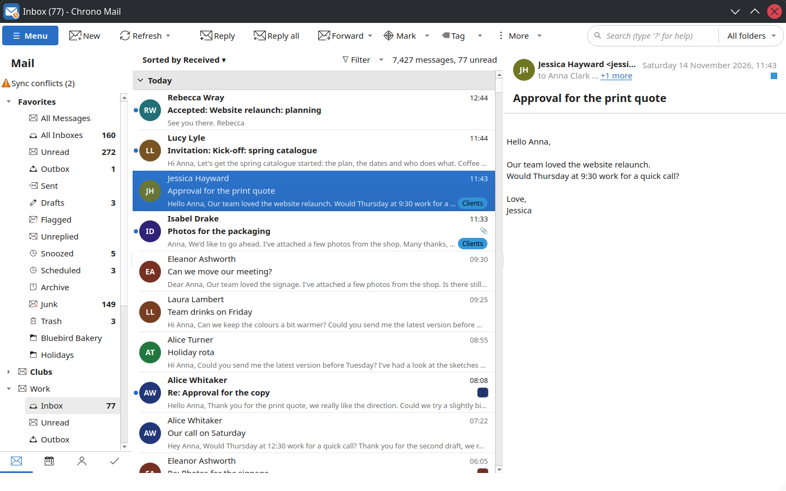
</picture>

#### The columns

Right-click a column heading to choose the columns. You can show:

1. **Unread**, **Flagged**, **Attachment**, **Replied** and **Contact**: small marks. A click in the Unread or Flagged column turns that mark on or off for that message. A click on the Contact mark opens the sender in Contacts.
2. **Delete**: a small bin; a click deletes that message.
3. **From / To**: the sender, or in Sent, Drafts, the Outbox and Scheduled the people you wrote to.
4. **From** and **To**, each shown as **Name and email**, **Name only** or **Email only** (choose in the column's submenu, or **Don't show**).
5. **Account**: which of your accounts received the message.
6. **Subject**, **Tags**, **Received**, **Sent** (called Saved in Drafts), **Size**, **Folder**, **Preview**, **Messages in conversation**, and **Snoozed until** (or **Send at** in Scheduled and the Outbox).

Drag a column heading to move it, and drag its edge to change its width. Every folder keeps its own columns; **Apply to all folders** (in the heading's menu and in **Menu > Folder**) gives every folder the columns of this one. **Message list…** in the same menu opens a window with all these choices together.

#### Sorting

Click a column heading to sort by it; click again to turn the order around. The sort follows what the column shows. Messages with the same value are ordered by when they were received, newest first, or oldest first if you choose so in **Settings > Message list > Secondary sort**.

#### Groups

With **Menu > View > Show groups** ticked, the list is divided by headings that follow the sort: by date ("Today", "Yesterday", "Earlier this week" and so on), by size, by sender, and so on. Click a heading to fold it. After midnight the headings follow the new day by themselves.

#### Conversations

With **Menu > View > Show conversations** ticked (or **Show messages grouped as conversations** in **Settings > Message list**), replies are grouped with the message they answer. When you read a message that is part of a conversation, a bar above it lists the other messages of that conversation; click one to read it.

#### Selecting

Click a message to select it; Ctrl+click and Shift+click select more; Ctrl+A selects all. An action works on every selected message, also those far down the list that are not yet shown. After a message leaves the list (deleted, moved, archived), the next one is selected.

A message that is still being moved or changed on the server is greyed until it is done.

### Reading a message

Click a message to read it in the **reading pane**. Choose where the reading pane is with **Menu > View > Reading pane**: **At the right**, **At the bottom** or **Off**. With Off, nothing is opened or marked as read until you open a message.

Press Enter, or double-click, to open the message in a window of its own. A draft opens in the message editor instead.

<picture>
  <source media="(prefers-color-scheme: dark)" srcset="docs/images/message-window-dark.png">
  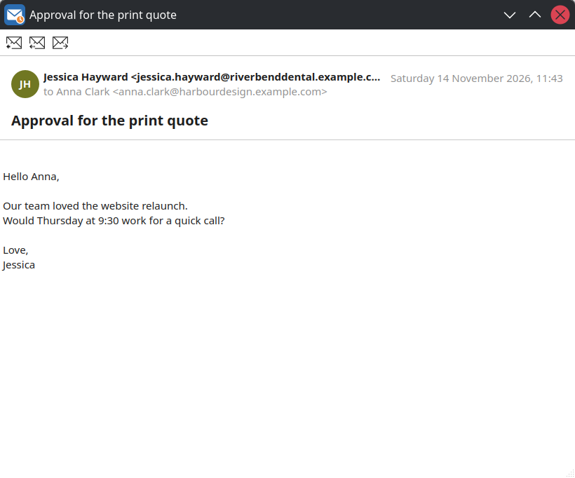
</picture>

A message is marked as read a moment after you select it. **Settings > Reading > Mark a message as read** can change this to **Only when I open it in a window of its own** or **Never by itself (I mark messages)**.

#### HTML mail and pictures from the internet

Many messages are written in HTML, with their own colours and layout. Chrono Mail shows them on a white page, without running any scripts.

Pictures and other content from the internet are not shown at first, to protect your privacy: loading them would tell the sender that you read the message. A bar above the message says so, with two buttons:

1. **Show remote content**: for this message, this once.
2. **Always for this sender**: for every message from this sender from now on.

**Settings > Reading** lists the senders you allowed, and can let you show it for every sender.

If a message has both a plain text and an HTML version, **Settings > Reading > Show the plain text of a message that has both text and HTML** shows the plain one.

#### Links

When you point at a link, the bottom line of the window shows the full address it leads to, before you click.

An orange triangle next to that address warns that the link leads to another domain than the sender's. That is not always wrong, but it is a reason to look twice.

When you click a link, Chrono Mail asks **Open this link in your web browser?** first, with the address. You can switch this question off in **Settings > Reading > Ask before opening a link in the web browser**.

Right-click a link and choose **Copy link address** to copy it without opening it.

#### Attachments

The files of a message are shown below its header. A click selects a file, a double-click opens it, and a right-click offers **Open attachment** and **Save as…**. A file that would run a program when opened is asked about first: only open it when you know the sender and expected the file.

Pictures that the message text does not show are shown below the text, and stay attachments too.

#### Saving, printing and the source

1. **Save as…** (Ctrl+Shift+S) saves the message as a file ending in .eml, as it was received.
2. **Print…** (Ctrl+P) prints the text of the message.
3. **View source** (Ctrl+Alt+U) shows the message as it was sent, with all its header lines, in a window with **Copy**.

You find these three in **Menu > Message** and in the right-click menu of a message.

### Writing a message

Click **New** (Ctrl+N) to write a message. **Reply** (Ctrl+R), **Reply all** (Ctrl+Shift+R) and **Forward** (Ctrl+F) start a message from the one you selected; **Forward as attachment** sends the original along unchanged as a file.

<picture>
  <source media="(prefers-color-scheme: dark)" srcset="docs/images/composer-dark.png">
  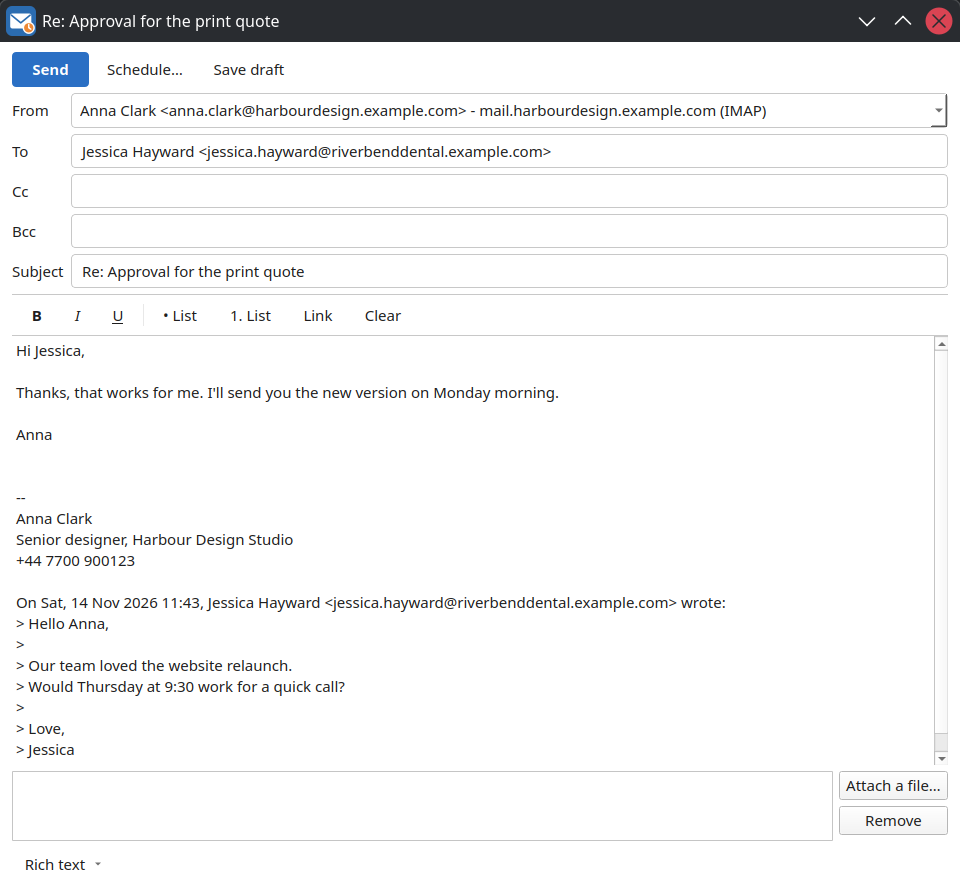
</picture>

The message window has:

1. **From**: the account the message is sent from. A reply goes from the account the original was addressed to.
2. **To**, **Cc** and **Bcc**. As you type, Chrono Mail suggests addresses you have seen before, and contact groups by name. It never suggests your own addresses.
3. **Subject**.
4. The text, with your signature at the end if the account has one.
5. **Attach a file…** and **Remove** for attachments. When you forward a message that has files, a tick offers **Include the attachments of the original message**.
6. At the bottom: **Save draft**, **Schedule…** and **Send**.

#### Rich text or plain text

A button at the bottom shows how you are writing: **Rich text** or **Plain text**; click it to switch. Rich text gives you a small row of buttons: **B** (bold, Ctrl+B), **I** (italic, Ctrl+I), **U** (underline, Ctrl+U), **• List**, **1. List**, **Link…** (Ctrl+K) and **Clear**. A rich text message is sent as text and as HTML, so every reader can read it.

New messages are written in rich text, unless you choose **Plain text** in **Settings > Writing > New messages are written in**.

#### Signatures

Each account has its own signature: **Edit account > General > Signature**. It is added at the end of new messages, replies and forwards.

#### Replies

**Settings > Writing > Replies** decides where your answer goes: **My answer above the quoted text**, **My answer below the quoted text**, or **Do not quote the original**.

#### Drafts

Chrono Mail saves what you are writing as a draft every 30 seconds (change this in **Settings > Writing > Save a draft every**), and when you click **Save draft** (Ctrl+S). Drafts are in the Drafts folder; select one and choose **Edit draft** to go on writing.

When you close a message you have not sent, Chrono Mail asks **Save it as a draft?** Nothing you wrote is lost without that question.

### Sending, sending later and the Outbox

Click **Send** (or Ctrl+Enter). If the subject is empty, Chrono Mail asks first (switch this off in **Settings > Writing**).

A message goes into the **Outbox** first and leaves from there. If you are offline, it waits in the Outbox and goes with the next Refresh.

#### Taking a message back

In **Settings > General**, tick **Delay sending a message by** and choose a number of seconds (10 at the start). After you click Send, a small notice at the bottom left of the window says **Sending "subject" in 10 s**, with:

1. **Send now**: it goes at once.
2. **Cancel**: it is not sent, and opens again for you to change.

**Delay sending messages until the next refresh** keeps sent messages in the Outbox until the next Refresh.

If you quit Chrono Mail while messages wait in the Outbox, it asks first: **Send now**, **Quit anyway** (they stay in the Outbox for next time), or cancel. Tick **Do not warn again** to stop the question, or untick **Warn when quitting with messages in the Outbox** in Settings > General.

#### Sending at a time you choose

Click **Schedule…** instead of Send. The window **Schedule** asks **Send this message at:**, with quick choices such as **In an hour**, **This evening**, **Tomorrow morning** and **Monday morning**, or a date and time of your own.

To send the same message again and again, tick **Send it again and again, every** and choose a number of months, weeks and days, and if you like **Stop after** a date.

A scheduled message waits in the **Scheduled** folder, with its time in the **Send at** column. Chrono Mail must be running to send it at its time.

#### Settings > Scheduled messages

**Settings > Scheduled messages** lists every message that is waiting to be sent, and every snoozed message, under **Waiting to be sent, and put away until a time:**. Its buttons:

1. **New**: write a new message that is sent at a time you choose.
2. **Edit**: change the message; it stays scheduled.
3. **Send now** (or **Cancel snooze** for a snoozed message).
4. **Pause** and **Resume** for a repeating message.

To turn a scheduled message back into a draft, move it to Drafts. To drop it, delete it.

<picture>
  <source media="(prefers-color-scheme: dark)" srcset="docs/images/settings-scheduled-dark.png">
  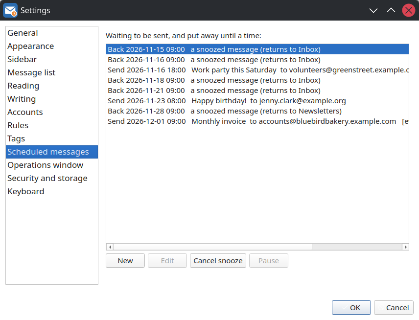
</picture>

### Keeping your mail in order

#### Moving and copying

1. **Move to** on the toolbar lists your accounts and their folders.
2. **Quick move** (M) and **Move to folder…** (Ctrl+Shift+V) open a list of folders you can type in to find one; **Quick copy** (C) and **Copy to folder…** (Ctrl+Shift+C) copy instead.
3. Drag messages onto a folder in the folder list.

Messages can be moved to a folder of another account as well. Each message is stored in the other account and checked before it leaves its own, so that a message is never lost on the way.

#### Archive

**Archive** (A) moves the selected messages to the account's Archive folder, which is made when needed. Chrono Mail remembers where each message came from: when every selected message is in an archive folder, the button reads **Unarchive** and puts them back where they came from (or in the Inbox).

#### Snooze

**Snooze** (S) puts a message away until a time you choose. It goes to the **Snoozed** folder and comes back, unread, at that time. The menu offers **Tomorrow**, **Later this week**, **This weekend** and **Next week**, each at 09:00 and with its day and time beside it, and **Custom date and time…**. Later this week and This weekend are left out when they would not lie ahead any more (Later this week from Thursday on, This weekend on Saturday and Sunday). A snoozed message offers **Cancel snooze**. Chrono Mail must be running for a message to come back at its time.

#### Read, unread and flags

1. **Mark as read** (Ctrl+Q) and **Mark as unread** (Ctrl+U); R switches between the two.
2. **Flag** and **Remove flag**; the Insert key switches.
3. **Mark all as read** in a folder's right-click menu marks the whole folder.
4. In the Unread view, a message you mark as read stays until you leave the view, so it does not vanish while you look at it. **Settings > Message list > Remove messages from Unread when I mark them as read** takes it out at once.

#### Deleting

1. **Delete** (the Delete key) moves messages to Trash. Undo brings them back.
2. Deleting a message that is already in Trash removes it for good, after a question.
3. **Delete permanently…** (Shift+Delete) removes messages for good without a stop in Trash, after a question. This cannot be undone.
4. **Empty folder…** in the right-click menu of Trash or Junk removes everything in it for good, after a question.

#### Moving through your mail

1. F and B: the next and the previous message.
2. N and P: the next and the previous unread message. When a folder has no more unread mail, N goes on to the next folder of that account that has some.
3. G (**Go to folder…**): type part of a folder name and press Enter.

### Junk mail

Junk mail goes to the **Junk** folder. With **Filter junk mail** ticked for an account (**Edit account > General**), new mail in its Inbox goes to Junk before your rules run when:

1. The server marked it as spam, or
2. It looks very much like junk, judged by what the filter learned.

The filter learns from you: **Move to Junk** (Ctrl+J) and **Not junk (move to Inbox)** teach it, and so do the server's own marks. It never learns from its own guesses. Mail from your contacts, from people you wrote to, and from senders a rule names is never treated as junk. What the filter learns stays on this computer, encrypted.

In the Junk folder, Ctrl+J moves the selected messages back to the Inbox.

### Tags on mail

Tags are coloured labels you give messages, such as "Important" or "Family". A message can have several.

1. Select messages and click **Tag**. Click a tag to give it to all selected messages; click a tag they all have to take it away. **New tag…** makes a new one; **Manage tags…** opens Settings > Tags.
2. A tag with a shortcut (Ctrl+Alt+1 to Ctrl+Alt+9, set in Settings > Tags) is given with that key.
3. The **Tags** column shows small coloured tags. **Settings > Message list > Use the tag's colour for the text of tagged messages** colours the whole line.

The **Tags** block below the folder list lists every tag that some mail carries, with its number. Click a tag to show only the messages with that tag in the folder or view you are in; the **Filter** button turns blue, and the tag's line turns blue with a check mark. Click the tag again, or choose **Filter > Clear filter**, to see everything again. Choose **Favorites > All Messages** and click a tag to see every message with that tag, wherever it is.

<picture>
  <source media="(prefers-color-scheme: dark)" srcset="docs/images/mail-tag-filter-dark.png">
  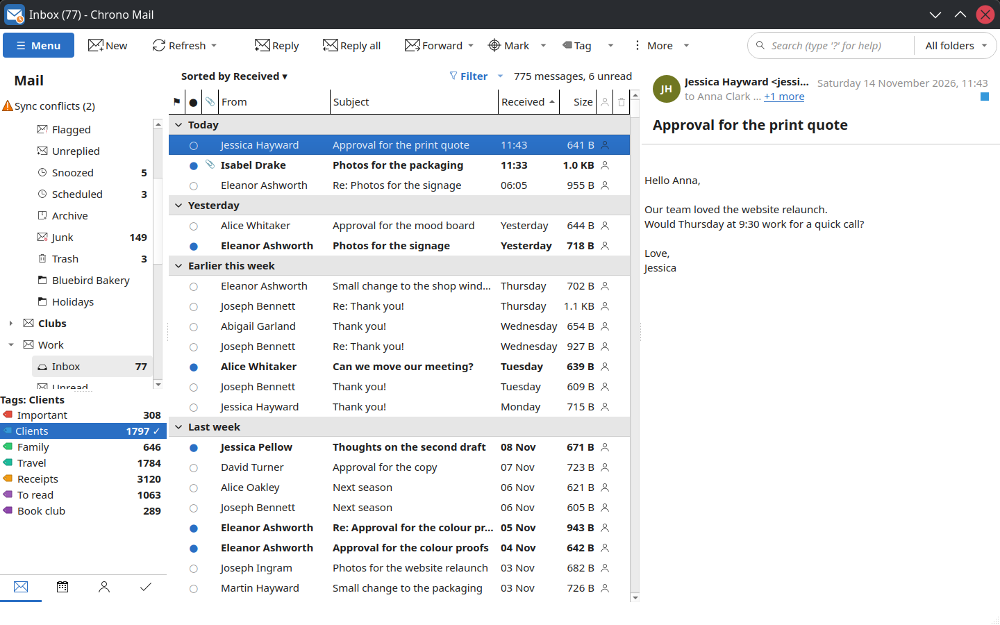
</picture>

On IMAP accounts, tags are stored on the server where it allows that, so your other computers see them too. Where the server does not allow it, they stay on this computer.

See [Tags](#tags) for how to make and change tags.

### Rules

Rules handle new mail as it arrives in the Inbox: move it to a folder, mark it, flag it, tag it. Open them with **Menu > Rules…** or **Settings > Rules**.

1. Click **New…** to make a rule, **Edit…** to change one, **Delete…** to remove one.
2. Rules run in the order of the list. **Move up** and **Move down** change the order.
3. **Apply to this folder** runs the rules now on the folder you are in.

The rule window has:

1. **Name**.
2. **For**: **All accounts**, or one account or several.
3. **Conditions**: **All of these conditions are true** or **Any of these conditions is true**, then one line per condition. **Add a condition** adds a line. A condition looks at **From**, **To**, **Cc**, **Subject**, **Message text**, **Header** (a header line you name, such as List-Id), **Size (KB)**, **Attachment** or **Tag**, with words such as **contains**, **does not contain**, **is**, **is not**, **starts with**, **ends with**, **is larger than** and **is smaller than**. A rule limited to accounts may have no conditions at all.
4. **Then:** one or more actions: **Move to folder**, **Mark as read**, **Mark as unread**, **Flag**, **Remove the flag**, **Move to Trash**, **Mark as junk**, **Add tag**, **Remove tag** and **Stop processing rules**. **Add an action** adds one; **Move up** and **Move down** order them.

A rule with **Stop processing rules** ends the rules for that message. A rule that fails never stops your mail from arriving. When a folder a rule uses is renamed, the rule follows it.

<picture>
  <source media="(prefers-color-scheme: dark)" srcset="docs/images/rule-editor-dark.png">
  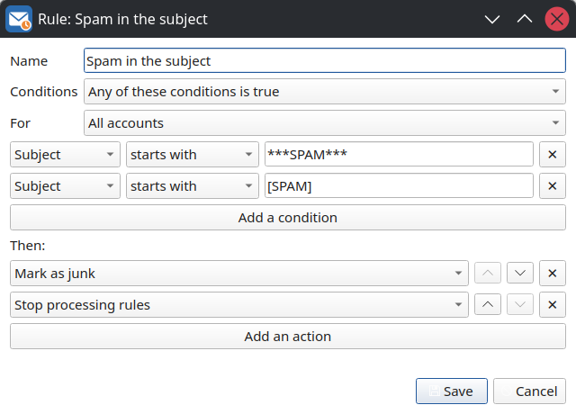
</picture>

### Finding mail

#### The search field

Type in the search field at the top right (Ctrl+E takes you there) and press Enter. The button at the left of the field chooses where to look: **This folder only**, **This folder + subfolders** or **All folders**. All folders looks in every folder of every account, Junk and Trash included.

Words you can use:

1. Plain words: found in the subject, the sender, the recipients and the message text. Every word must be there.
2. `from:anna`, `to:tom`, `subject:invoice`, `body:receipt`: the word in that part only.
3. `"exact phrase"`: these words together, in this order.
4. `-word` (or `NOT word`): leave out messages that contain this word.
5. `OR` (or `|`) between words: either one will do.
6. `tag:Family`, or `tag:"two words"`: messages with that tag; `-tag:Family` leaves them out.

Type a single `?` in the field to see a short list of the most used words (plain words, `from:`, `to:`, `subject:`, `body:`, an exact phrase and `-word`); `OR` and `tag:` work too, though that list leaves them out. The field also remembers your recent searches.

<picture>
  <source media="(prefers-color-scheme: dark)" srcset="docs/images/search-dark.png">
  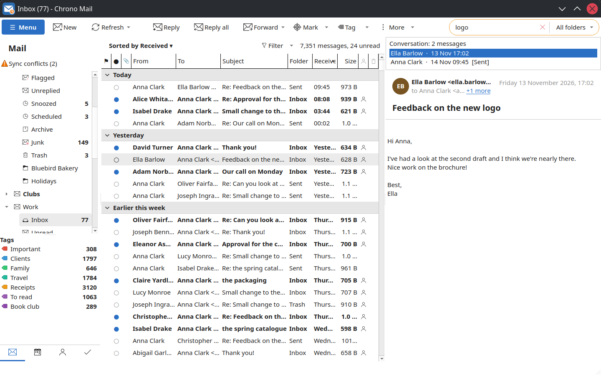
</picture>

In a search of several folders, each message behaves as it does in its own folder.

#### The Filter button

**Filter**, above the message list, narrows what you see: **Flagged**, **Unread**, **With attachments**, and **Tagged with** a tag. It is blue while a filter is on; **Clear filter** takes it off. Filters work in every folder, in Favorites and together with a search.

#### Advanced search

**Advanced search…** (Ctrl+Shift+F, in **Menu > View**, or in the menu of the where-to-search button) builds a search step by step:

1. **Where to search**.
2. **Find messages that match ALL / ANY of these conditions**, then lines such as "anywhere contains all of these words …". A line can look **anywhere**, or in **from**, **to**, **subject** or **body**, and ask for **all of these words**, **any of these words**, **this exact phrase** or **none of these words**. The **+** and **−** buttons add and remove lines.
3. **Received**: **Any time**, **Today**, **Yesterday**, **Last 7 days**, **Last 30 days**, **This month**, **Last month**, **This year**, **Last year**, **Between…**, **Before…** or **After…**.
4. **More...** opens the rest: **Sent**, **Size** (**at least**, **at most**), **Only** (**Unread**, **Flagged**, **With attachments**), **Tag**, **Snoozed until** and **Send at**.

Click **Search**. The words go into the search field, where you can still change them.

**Saved searches** keeps searches you use often: **Save**, **Save as**, **Rename**, **Delete** and **Reset**.

<picture>
  <source media="(prefers-color-scheme: dark)" srcset="docs/images/advanced-search-dark.png">
  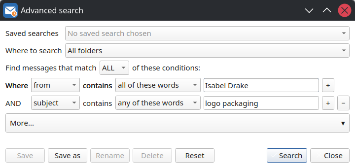
</picture>

### Undo and Redo

**Undo** (Ctrl+Z) takes back what you did to your mail: a delete, a move, an archive, a snooze, a mark, a tag, a junk verdict. Each message goes back where it was, with its marks and tags as before. **Redo** (Ctrl+Y or Ctrl+Shift+Z) does it again. **Menu > Message** shows what Undo would take back.

An undo is an action of its own, so on IMAP accounts the server is asked first, as for every action. A message that changed in the meantime is left alone, and Chrono Mail says so.

Not undone: what rules and the junk filter did, timers, deleting for good, sending, and turning a scheduled message back into a draft.

### Refresh and the Operations window

#### Refresh

**Refresh** (F5) is Send and Receive: it sends what waits in the Outbox, fetches new mail, and brings your calendars, contacts and tasks in step with their servers. It does the same wherever you press it, in Mail, Calendar, Contacts or Tasks.

The arrow next to Refresh opens its menu:

1. **Send and Receive All**, **Receive All** and **Send All**.
2. Each account by itself ("Work" only), with **Send and Receive**, **Send** and **Receive**. A calendars-only account has one entry that brings it in step.

By itself, Chrono Mail refreshes in only two ways, both in **Settings > General**:

1. **Refresh when the program starts**.
2. **Automatic refresh every** so many minutes (30 at the start). **Menu > View > Refresh automatically** switches it on and off quickly.

Each can be set to **Send and Receive**, **Receive only** or **Send only**. While Automatic refresh is on, Chrono Mail also listens to IMAP servers that announce new mail, and fetches it as soon as it arrives.

Nothing else sends or receives by itself: not a restore, not an import, not a change of settings. A new account does one first fetch of its mail, and nothing more.

#### The Operations window

Every Send and Receive shows its progress in the **Operations** window: one row per account, with what it is doing and a bar. Open it with **Menu > View > Operations…**.

1. **Operations**: the accounts at work.
2. **Errors**: what went wrong, per account, with the time. **Ignore All** clears them.
3. **Log**: what happened, step by step. **Copy Log** and **Clear Log**. The log never holds the contents of your mail or your passwords.

**Hide when all operations are complete** closes the window when everything is done. **Settings > Operations window** decides when it opens and closes.

<picture>
  <source media="(prefers-color-scheme: dark)" srcset="docs/images/operations-dark.png">
  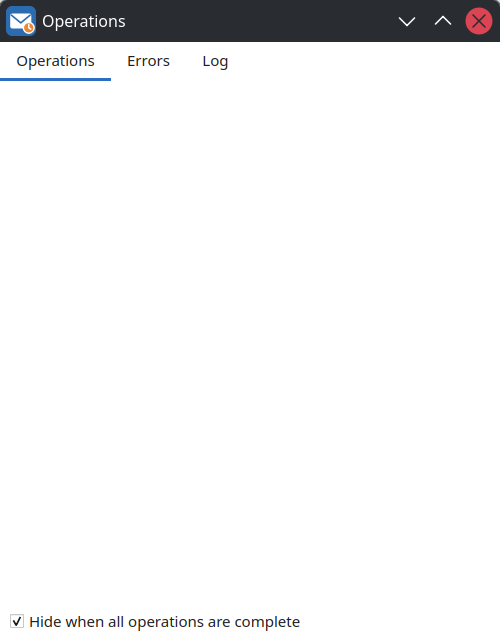
</picture>

#### New mail notices

When new mail arrives, Chrono Mail shows a notification with only the number of new messages, never who sent them or what they say. Switch this off with **Settings > General > Show a notification when new mail arrives (only the number, never the content)**.

## Calendar

Press Ctrl+2, or click the Calendar button at the bottom left.

### The calendars

The sidebar lists your calendars per account, each with a tick box and its colour. Untick a calendar to hide its appointments for a while; tick it again to see them. Nothing is deleted and it stays in step with its server.

A blue plus marks the calendar new appointments go to. To change it, right-click another calendar and choose **Use for new appointments**.

Right-click in the sidebar for:

1. **Add account…**.
2. **New calendar…**: made in the account you right-clicked, on its server first.
3. **Use for new appointments**.
4. **Rename…** and **Colour…**.
5. **Fill colour for timed events** (only while Month is shown): draws this calendar's timed appointments in Month as coloured bars, as all-day ones are.
6. **Delete…**: deletes the calendar, also on its server, after a question that says so.

Some calendars can only be read, for example one a colleague shares with you. Their items cannot be changed, so Edit, Rename, Colour and Delete are greyed for them, with a hover text that says why.

**Settings > Sidebar > Calendar** decides which calendars the sidebar shows at all. A calendar left out there stays in step with its server but is not shown and never offered for new appointments.

### The views

The buttons at the top choose the view:

1. **Day**: one day, hour by hour.
2. **Work Week**: your working days.
3. **Week**: seven days.
4. **Upcoming**: the coming seven days, starting today.
5. **Month**: the whole month.
6. **Agenda**: a list of the coming 60 days. **Hide past events** hides what is over.

Above the view, **Today** goes to today, and **‹** and **›** go back and forward. **Show declined** shows the invitations you declined, greyed (see [Invitations and meetings](#invitations-and-meetings)).

The mouse wheel goes through the months in Month, and through the periods when you point at the day names. Over the hours it scrolls; Ctrl and the wheel make the hours taller or shorter. After midnight every view follows the new day by itself.

<picture>
  <source media="(prefers-color-scheme: dark)" srcset="docs/images/calendar-day-dark.png">
  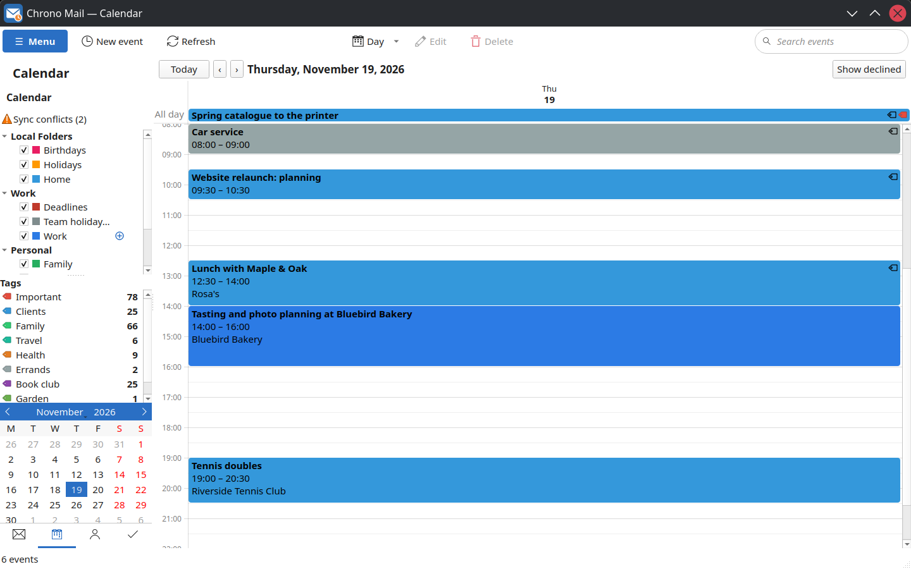
</picture>

<picture>
  <source media="(prefers-color-scheme: dark)" srcset="docs/images/calendar-week-dark.png">
  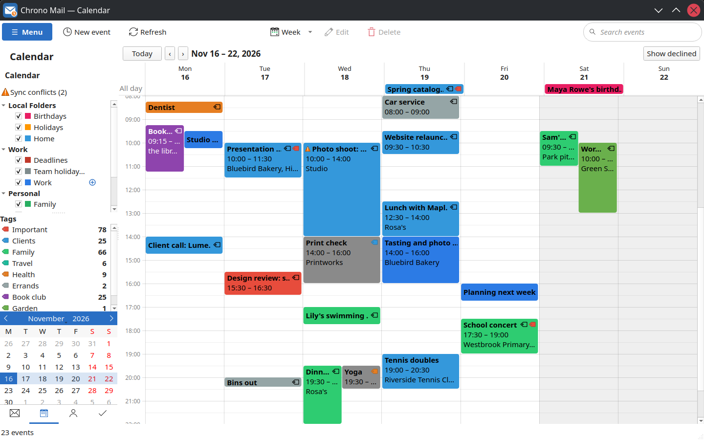
</picture>

<picture>
  <source media="(prefers-color-scheme: dark)" srcset="docs/images/calendar-month-dark.png">
  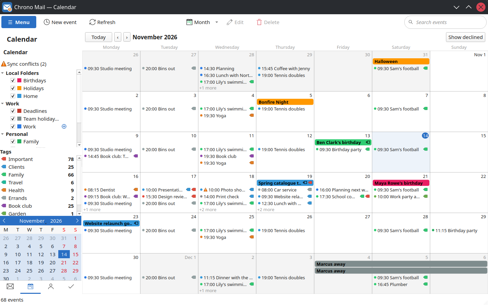
</picture>

<picture>
  <source media="(prefers-color-scheme: dark)" srcset="docs/images/calendar-agenda-dark.png">
  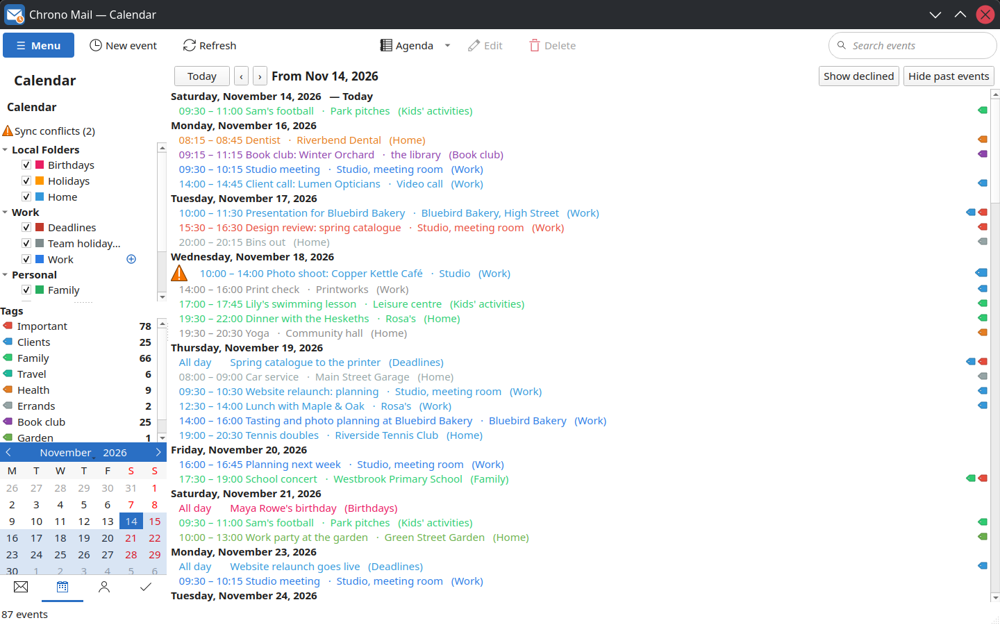
</picture>

The search field at the top right ("Search events") finds appointments by their words.

### A new appointment

1. Click **New event** (Ctrl+N), or double-click a free place in the calendar, or right-click it and choose **New event here**.
2. Fill in the appointment window and click **Save**.

A double-click in Month, or in the all-day row, starts an all-day appointment.

### The appointment window

<picture>
  <source media="(prefers-color-scheme: dark)" srcset="docs/images/appointment-dark.png">
  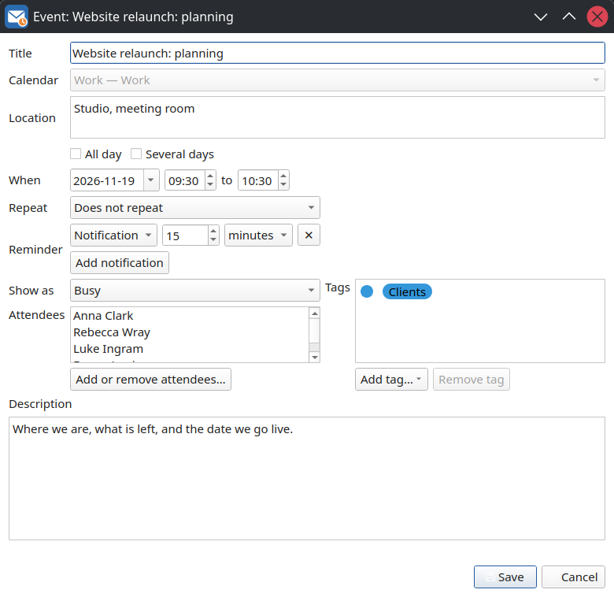
</picture>

1. **Title**.
2. **Calendar**: where it is kept. A calendar that can only be read is greyed.
3. **Location**.
4. **All day**, and **Several days** for an appointment over more than one day.
5. **When … to**: the start and the end. Moving the start moves the end along.
6. **Repeat**: **Does not repeat**, **Daily**, **Weekly on** this weekday, **Monthly on** (for example) **the second Tuesday**, **Annually on** this date, **Every weekday (Monday to Friday)**, or **Custom…**. Custom offers **Repeat every** so many days, weeks, months or years, **On these days**, and **Ends**: **Never**, **On** a date, or **After** so many occurrences.
7. **Reminder**: **Add notification** adds a reminder (up to five). Each is a **Notification** or an **Email**, so many minutes, hours, days or weeks before. **✕** removes one.
8. **Show as**: **Busy** or **Free**.
9. **Attendees**: **Add or remove attendees…** to invite people (see [Your own meetings](#your-own-meetings)).
10. **Tags**: **Add tag…** and **Remove tag**. The tags give the appointment its colour (see below).
11. **Description**.

To change an appointment, double-click it, select it and press Enter, or right-click it and choose **Edit…**. For a repeating appointment, Chrono Mail first asks whether to change this date only or all of them.

### Changing the title in place

In Day, Week and Month, click an appointment that is already selected, or press F2, to change its title right where it is. Enter or a click elsewhere saves it, Escape does not. A small clock shows until the server has taken the change.

### Colours come from tags

An appointment gets its colour from its tags. In the appointment window, each tag has a round button: the chosen one gives the colour. Every other tag shows as a small coloured tag at the end of the appointment's line. An appointment without tags has the colour of its calendar.

The **Tags** block below the calendars lists the tags used in the ticked calendars, with their numbers. Click a tag to show only its appointments; click it again for everything.

### The right-click menu of an appointment

1. **Edit…**.
2. For an invitation from someone else: **Accept**, **Tentative**, **Delegate…** and **Decline**.
3. **Cancel**: the appointment stays, greyed, and gives no reminders. **Restore** makes it active again. On your own meeting with attendees, Chrono Mail offers to tell them.
4. **Delete**.

On a cancelled appointment, only Restore and Delete can be used until you restore it.

### Reminders

Chrono Mail gives reminders itself while it is running: a notification "Reminder: title", or a small window when your desktop has no notifications. An **Email** reminder is mailed to your own address.

If Chrono Mail was closed when a reminder was due, it still reminds you when it starts, as long as the appointment has not begun. A cancelled or declined appointment gives no reminders.

### Calendar files

A calendar file (ending in .ics) holds one or more appointments or tasks. Chrono Mail shows it as a card:

1. As an attachment in a message, the card is shown above the message text. Click **Add to calendar**, or **Add all** for a file with several items.
2. Opened from your computer (right-click the file, **Open with**, Chrono Mail), the card opens in a window of its own. If Chrono Mail is already running, the file goes to the window that is open.

## Invitations and meetings

### An invitation in your mail

A message that holds an invitation shows a card above its text with the meeting's title, time, place and organizer, and the buttons:

1. **Accept**: choose the calendar it goes in, and it is added.
2. **Tentative**: the same, marked as tentative.
3. **Delegate…**: type the address of the person who goes in your place. Chrono Mail prepares the invitation for them, and tells the organizer.
4. **Decline**.

<picture>
  <source media="(prefers-color-scheme: dark)" srcset="docs/images/invitation-dark.png">
  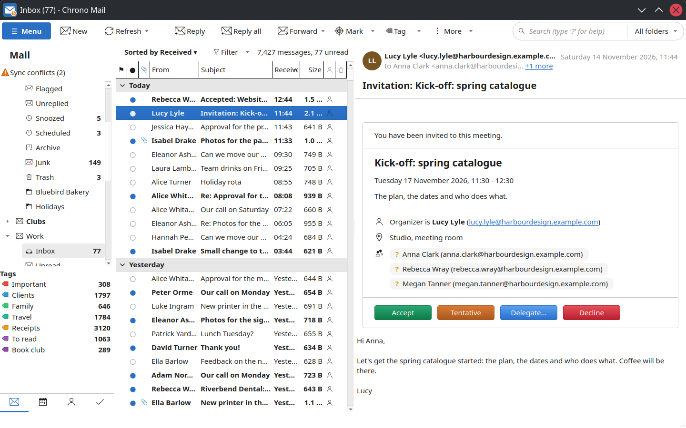
</picture>

Before Accept on a repeating meeting, Chrono Mail warns when it clashes with your own appointments in the coming year, and names them.

When your answer is to be mailed to the organizer, a short window asks **Tell the organizer that you accept?** (or decline), with an optional **Message**, and **Send** or **Don't send**. Closing that window takes the answer back; nothing changes. Who mails the answer, Chrono Mail or your calendar server, is set per account in **Edit account > Calendars and contacts > Send confirmation emails via**.

Once you have answered, the card says so and offers **Change my answer**. The message gets the Replied mark when the answer has gone.

### Declined invitations

A declined invitation stays in its calendar, hidden. You count as free at that time, and it gives no reminders. **Show declined**, above the calendar, shows them greyed. Accept or Tentative from its right-click menu makes it a normal appointment again.

### Updates and cancellations

1. When the organizer changes a meeting, the card says what changed and shows the old and the new time. If your answer still stands, **Update calendar** takes the change in. If the time moved, the four answers come back, so you can answer again.
2. When the organizer cancels a meeting, the card offers **Cancel in calendar** (or **Cancel this date in calendar** for one date of a series). The appointment stays in your calendar, greyed, marked Cancelled.

Chrono Mail never changes your calendar from a mail by itself: you decide with the buttons.

### Your own meetings

1. Open a new or existing appointment and click **Add or remove attendees…**. Type a name or an address, and click **Add**.
2. Click **Save**. Chrono Mail asks **Send the attendees an invitation?**, with an optional message.
3. When you change the meeting later, it asks **Send the attendees a mail about this change?**. An attendee you took off gets a cancellation.

Answers from your attendees arrive as mail with a card. **Their answer is in your calendar** once it is taken in. A proposal for a new time offers **Accept proposal** and **Decline proposal**. An attendee who asks for the latest version can get it with one click.

A request for your free and busy times offers **Send my busy times…**.

## Contacts

Press Ctrl+3, or click the Contacts button at the bottom left.

<picture>
  <source media="(prefers-color-scheme: dark)" srcset="docs/images/contacts-dark.png">
  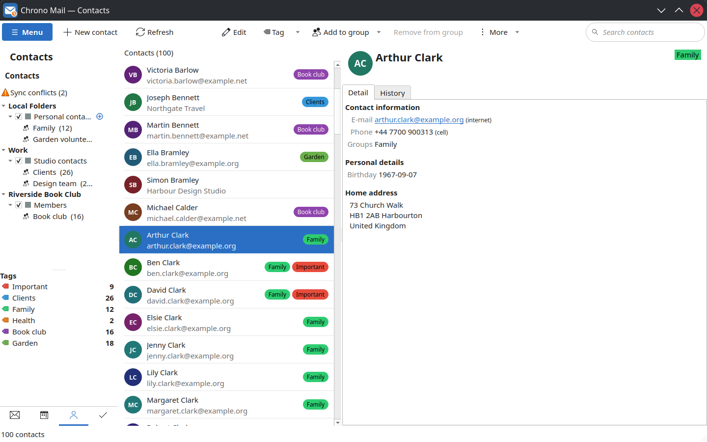
</picture>

### Address books and groups

The sidebar lists your address books per account, each with a tick box. The list shows the contacts of every ticked address book together, sorted by last name. The last ticked address book cannot be unticked. A blue plus marks where new contacts go; right-click another address book and choose **Use for new contacts** to change it.

Contact groups are shown under their address book. Click a group to see its members.

1. Right-click an address book for **Add account…**, **New address book…**, **New group…**, **Rename…** and **Delete…**.
2. Right-click a group for **Write an e-mail** (to all its members), **New group…**, **Rename…** and **Delete…**. Deleting a group never deletes its contacts.
3. Drag contacts onto a group to add them, or select them and choose **Add to group**. **Remove from group** on the toolbar takes the selected contacts out of the group you are looking at.

The **Tags** block below the address books works as in the other sections.

### One contact

Click a contact to see it on the right, with two tabs:

1. **Detail**: everything you know about the person. Click an e-mail address to write to it.
2. **History**: the mail you exchanged with this person.

In Mail, the Contact mark next to a sender opens that person here.

### The contact window

Click **New contact** (Ctrl+N), or double-click a contact, to open the contact window:

1. **Address book**.
2. **Title**, **First name**, **Middle names**, **Last name**, **Suffix**, **Display name** (made from the parts above when empty) and **Nickname**.
3. **Company**, **Department** and **Job title**.
4. **E-mail addresses**, **Phone numbers** and **Web addresses**, each with its kind and **Add**.
5. **Add an address**: **Kind**, **Street**, **City**, **State / region**, **Postal code** and **Country**; **Remove this address** takes one away.
6. **Birthday**.
7. **Note**.
8. **Tags**: **Add tag…** and **Remove tag**.

Click **Save**.

<picture>
  <source media="(prefers-color-scheme: dark)" srcset="docs/images/contact-editor-dark.png">
  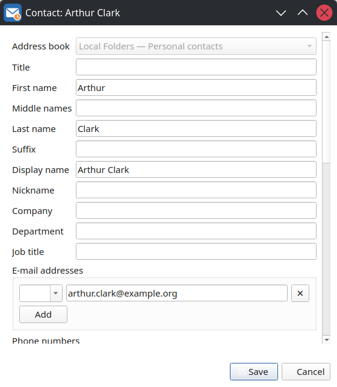
</picture>

### More you can do

The right-click menu of a contact offers **New contact**, **Edit**, **Write an e-mail**, **Tag**, **Add to group**, **Move to address book** and **Delete**. Delete asks first. Undo (Ctrl+Z) works on mail only, so a deleted contact cannot be brought back from within Chrono Mail.

**Import vCard file…** on the toolbar brings in contacts from a vCard file (.vcf); **Export this address book…** writes the address book to one.

The search field ("Search contacts") finds contacts by their words.

## Tasks

Press Ctrl+4, or click the Tasks button at the bottom left.

<picture>
  <source media="(prefers-color-scheme: dark)" srcset="docs/images/tasks-dark.png">
  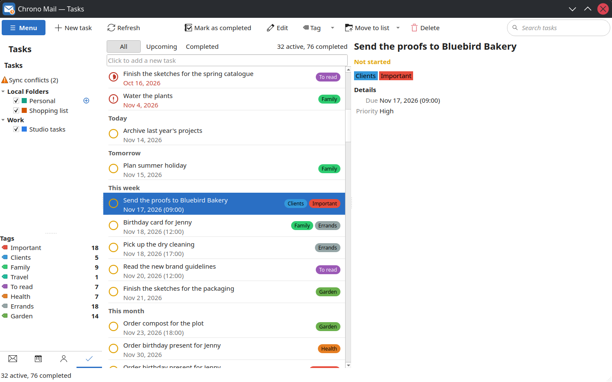
</picture>

### Task lists

The sidebar lists your task lists per account, each with a tick box. A blue plus marks the list new tasks go to; right-click another list and choose **Use for new tasks** to change it. The right-click menu also has **Add account…**, **New task list…**, **Rename…**, **Colour…** and **Delete…**.

### The list of tasks

1. **Click to add a new task**, at the top, adds a task with just a name: type it and press Enter.
2. The tabs **All**, **Upcoming** and **Completed** choose what you see.
3. Tasks are grouped by due date: **Overdue**, **Today**, **Tomorrow**, **This week**, **This month**, **Later**, **No due date** and **Completed**. After midnight the groups follow the new day by themselves.
4. **Mark as completed** on the toolbar finishes the selected tasks.
5. The right-click menu has **New task**, **Edit**, **Tag**, **Move to list** and **Delete**.

### The task window

Click **New task** (Ctrl+N), or double-click a task:

1. **Summary**.
2. **Task list**.
3. **Start** and **Due**, each with a date, a time or **All day**, or left out.
4. **Priority**: **None**, **High**, **Normal** or **Low**.
5. **Status**: **Not started**, **In progress**, **Completed** or **Cancelled**.
6. **Done**: how far along it is, in percent.
7. **Repeat**: **Does not repeat**, **Every day**, **Every week**, **Every month** or **Every year**.
8. **Reminder**: **Add notification**, up to five, each a **Notification** or an **Email**, so long before the due time, or **At a set time…** with a date and a time. A task without a due date can only have reminders at a set time.
9. **Location**.
10. **Tags**: **Add tag…** and **Remove tag**.
11. **Note**.

Click **Save**. A completed or cancelled task gives no reminders; set its Status back to bring them back.

<picture>
  <source media="(prefers-color-scheme: dark)" srcset="docs/images/task-editor-dark.png">
  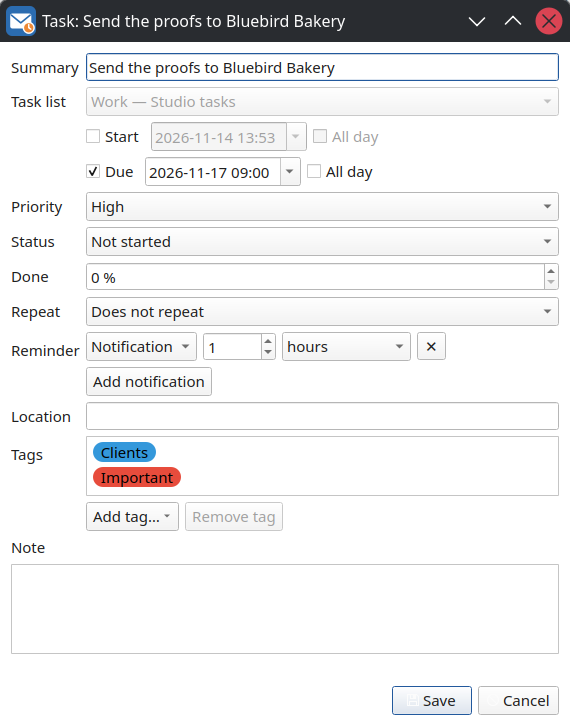
</picture>

## Tags

There is one list of tags for all of Chrono Mail. Each tag has one name, one colour and at most one shortcut, and you choose in which sections it is offered.

### Settings > Tags

Open it with **Menu > Tags…**, or **Manage tags…** in a Tag menu.

<picture>
  <source media="(prefers-color-scheme: dark)" srcset="docs/images/settings-tags-dark.png">
  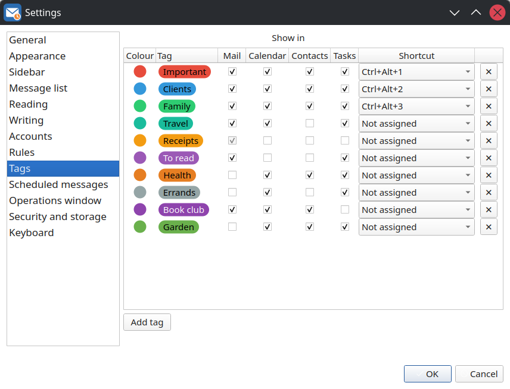
</picture>

Each line is one tag:

1. **Colour**: click the circle to pick another colour.
2. **Tag**: the name. Click the name of a selected line, or press F2, to rename it.
3. **Show in**: **Mail**, **Calendar**, **Contacts** and **Tasks**. A section offers only the tags shown in it. A message or item keeps a tag it already has.
4. **Shortcut**: **Not assigned**, or one of Ctrl+Alt+1 to Ctrl+Alt+9. A key another tag has is greyed, with that tag's name.
5. **✕**: delete the tag. It is taken away from every message and item that carries it; they stay.

**Add tag** adds a line. Drag a line to put it in another place. Click **OK** to keep the changes.

The very first time Chrono Mail starts on a computer, it gives you eleven tags to begin with, in clearly different colours: Tomato, Flamingo, Tangerine, Banana, Sage, Basil, Peacock, Blueberry, Lavender, Grape and Graphite. Rename or delete them as you like.

### Tags in the sections

1. In **Mail**, the **Tag** button and the right-click menu give tags; see [Tags on mail](#tags-on-mail).
2. In **Calendar**, the tags of an appointment give it its colour; see [Colours come from tags](#colours-come-from-tags).
3. In **Contacts** and **Tasks**, the right-click menu has **Tag**, with **New tag…** and **Remove all tags**, and the windows have **Add tag…** and **Remove tag**.

Every section has a **Tags** block in its sidebar, below the folders, calendars, address books or task lists. It lists the tags in use with their numbers. Click a tag to show only its items; its line turns blue with a check mark, and the heading reads "Tags: name". Click it again to see everything. Drag the line above the block to give it more or less room. **Settings > Sidebar** can hide the block per section.

### Everything of one tag

Right-click a tag in any Tags block and choose **Show everything tagged…**. The **Tag overview** window shows, in one list, everything that carries that tag: **Contacts**, **Appointments** to come (earlier ones folded away), open **Tasks** (finished ones folded away) and **Mail**, newest first. **Search within this tag** narrows the list. Double-click an item to open it. The overview only shows: nothing is changed, and no mail is marked as read.

<picture>
  <source media="(prefers-color-scheme: dark)" srcset="docs/images/tag-overview-dark.png">
  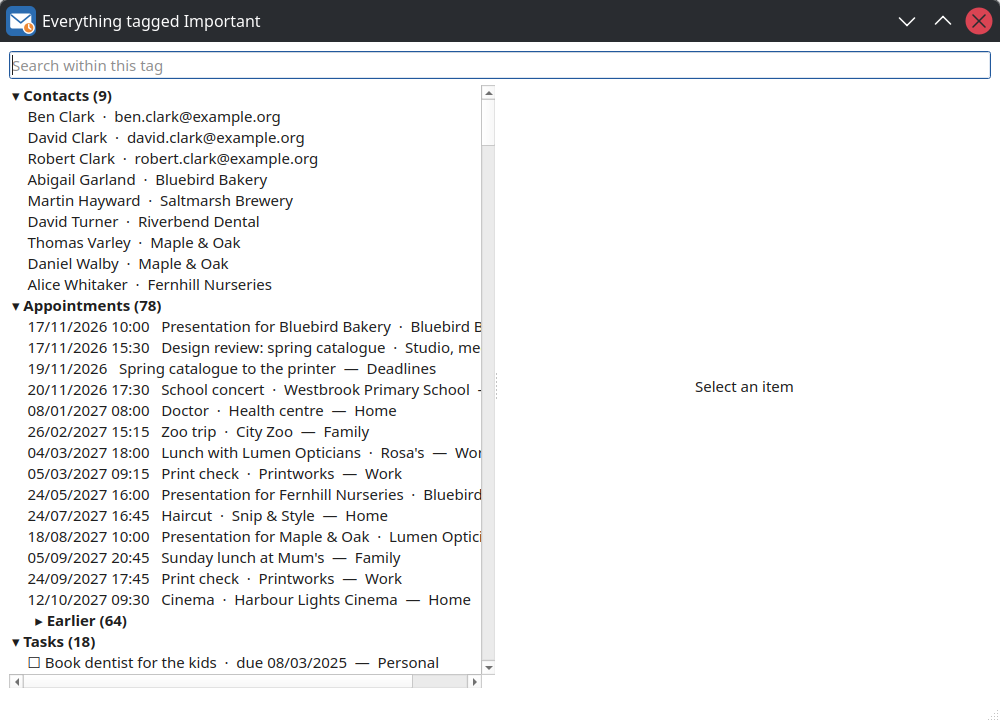
</picture>

### Google Calendar's colours

The colours you give appointments in Google Calendar are tags here, named as you named them in Google, or with Google's own colour name (such as Tomato or Banana). Each is shown with its calendar's name, such as "Tomato (Family)", so two calendars never mix their colours. These tags are not in Settings > Tags: rename or recolour them in Google Calendar, and Chrono Mail follows at the next Refresh. Giving a Google appointment such a tag here gives it that colour in Google too.

## Working offline and staying in step

### The rule Chrono Mail follows

An IMAP account, a calendar, an address book or a task list on a server is a faithful copy of what is on that server:

1. What you do goes to the server first, and shows here when the server has taken it. Until then, the message or item is greyed, or shows a small clock.
2. What changes on the server, by your phone, another computer or your provider's website, shows here at the next Refresh: new, changed, moved, renamed and deleted items and folders.
3. Two computers on the same account end up showing the same.

POP3 accounts and Local Folders are different: their mail lives here.

### Offline

When you have no connection, you can keep working. What you do is done here at once, remembered even if you close Chrono Mail, and sent to the server when the connection is back. Messages you send wait in the Outbox.

### When the server and Chrono Mail disagree

Sometimes the server and Chrono Mail cannot simply agree, for example when an appointment was changed both here (offline) and on your phone, or when the server refuses a change for good. That is a **sync conflict**, and you decide what happens. A passing failure, such as a dropped connection, is not a conflict: it is simply tried again.

When there are sync conflicts, **Sync conflicts (n)** appears in the sidebar, and the items involved carry a small triangle. Open the window with that entry, with **Menu > Sync conflicts…**, or by clicking an item's triangle.

<picture>
  <source media="(prefers-color-scheme: dark)" srcset="docs/images/sync-conflicts-dark.png">
  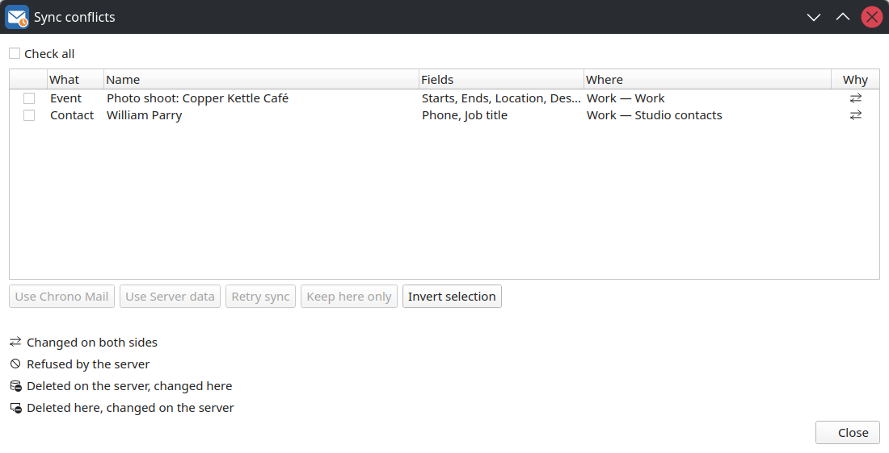
</picture>

The **Sync conflicts** window lists every conflict, with **What** it is, its **Name**, the **Fields** that differ, **Where** it is, and **Why**, as an icon:

1. **Changed on both sides**.
2. **Refused by the server**.
3. **Deleted on the server, changed here**.
4. **Deleted here, changed on the server**.

Tick conflicts (**Check all**, **Invert selection**) and settle them together:

1. **Use Chrono Mail**: what you have here goes to the server.
2. **Use Server data**: the server's version comes here.
3. **Retry sync**: send it again, for example after you fixed something on the server.
4. **Keep here only**: keep your version on this computer only.

Double-click a conflict to settle it field by field. The window **Sync conflict** shows every field with Chrono Mail's value and the server's value; where they differ, choose a side per field, or **Chrono Mail** or **Server** for all of them at once. For a field that can hold several values, such as phone numbers, **Keep both** keeps both. **Keep both** for the whole item makes two items: the server's version, and yours as a copy. Click **Apply**.

<picture>
  <source media="(prefers-color-scheme: dark)" srcset="docs/images/sync-conflict-dark.png">
  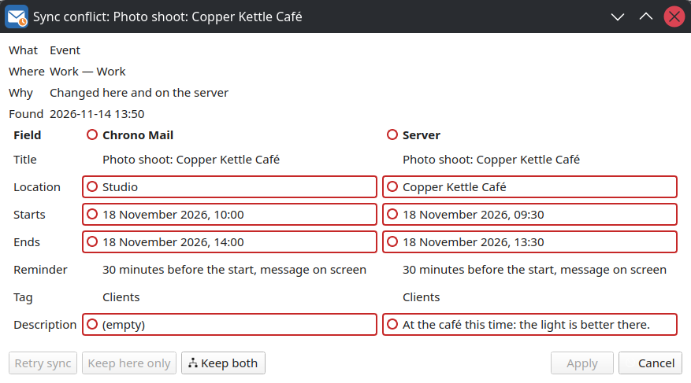
</picture>

Only what you can see and enter counts: differences in hidden details always take the server's version, without a question. Tags and group members never make a conflict: what was added on either side is kept.

### Messages out of step

Rarely, a Refresh finds that messages you deleted here are still on the server, or that messages here are gone from the server. Chrono Mail then asks what should happen, with buttons such as **Delete them on the server too**, **Bring them back here**, **Remove them here too** or **Keep them here**. Nothing is deleted without that question.

## Import and export

### Import from another mail program

**Menu > File > Import…** brings your accounts, mail, contacts, calendars, rules and tags over from another mail program. The window lists the programs under **Applications**:

<picture>
  <source media="(prefers-color-scheme: dark)" srcset="docs/images/import-dark.png">
  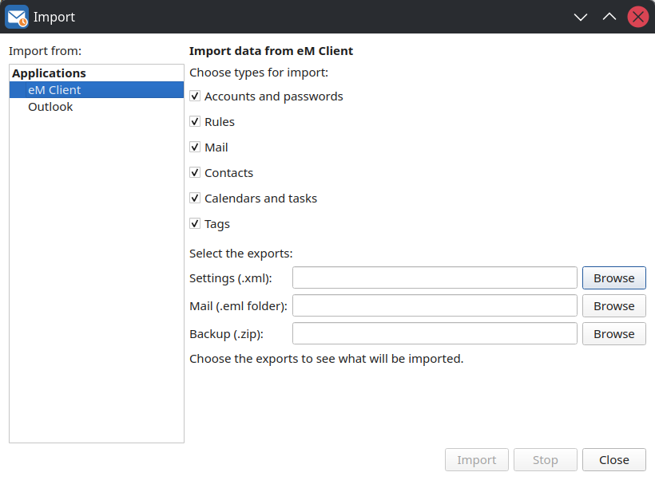
</picture>

#### From eM Client

First make the exports in eM Client, then in Chrono Mail:

1. Choose **eM Client**.
2. Under **Select the exports:**, choose the files with **Browse**: **Settings (.xml)**, **Mail (.eml folder)** and **Backup (.zip)**.
3. Under **Choose types for import:**, tick **Accounts and passwords**, **Rules**, **Mail**, **Contacts**, **Calendars and tasks** and **Tags**.
4. Chrono Mail reads the exports and says what will be imported. **Import** becomes usable as soon as the exports have been read.
5. Click **Import**.

#### From Outlook

1. Choose **Outlook**.
2. Under **Data files (.pst)**, choose the data files with **Browse**.
3. Tick **Mail**, **Calendar**, **Contacts**, **Tasks** and **Tags (categories)**. **Accounts**, **Rules** and **Signatures** can only be read on Windows, on the computer where Outlook itself is; elsewhere they are greyed with an (i) that says so.
4. Click **Import**.

#### What an import does

1. Everything is imported as it was, in the same folders. Only what cannot be imported is reported.
2. Categories become tags.
3. Mail of IMAP accounts is not imported: it comes from their servers, as soon as the account is here.
4. Mail of a POP3 account goes into that account; other mail goes into Local Folders.
5. Imported mail is never sent, and nothing checks for mail while the import runs.
6. **Stop** stops the import; **Import** later continues where it stopped. Importing the same again asks first, and brings nothing in twice.

### Export

**Menu > File > Export…** writes your data for another mail program. Choose **Outlook** under the programs, then:

1. Tick what to export: **Mail**, **Calendar**, **Contacts and contact groups**, **Tasks**, **Tags (as categories)**, **Accounts (a profile file to import)** and **Rules**.
2. Choose the **Accounts:**. A POP3 account becomes a data file of its own; an IMAP account is exported as an account only, because its mail comes from its server; Local Folders becomes a data file with your calendars, contacts and tasks.
3. Choose the **Folder to write the files in:** with **Browse**, and click **Export**.

Passwords are never exported.

You can also save single messages as .eml files (**Save as…**), and an address book as a vCard file (**Export this address book…** in Contacts).

## Backup and restore

A backup is Chrono Mail's own file, ending in **.cmz**. It holds the accounts you choose, exactly as they are kept here, so that you can bring everything back after losing this computer, or move to another one.

A backup holds your mail readable, so that it can be restored on any computer. Protect it with a password (step 4 below) whenever the file leaves this computer or is kept where others can reach it, such as a USB stick or a shared drive: then nobody can open it without that password.

### Making a backup

1. Choose **Menu > File > Backup…**.
2. Under **What to back up**, tick **Messages**, **Mail rules**, **Calendar items**, **Contacts**, **Tasks** and **Settings**.
3. Under **Accounts**, tick the accounts (**Select all** ticks them all).
4. If you like, tick **Protect the backup with a password**. Chrono Mail makes a strong password for you; click **Copy**, keep it somewhere safe, and tick **I have saved the backup password**. Without it the backup cannot be opened, and it cannot be recovered.
5. Tick **Include account passwords** if you want your passwords in it. Passwords never go into a backup without a password, so the backup is then always protected.
6. Click **Backup…** and choose where to save the file. Its name starts as "Chrono Mail backup" with today's date.

**Run in background** lets you go on working while the backup is made. When it is done, Chrono Mail says where the file is, how large it is, and how many messages and items it holds.

<picture>
  <source media="(prefers-color-scheme: dark)" srcset="docs/images/backup-dark.png">
  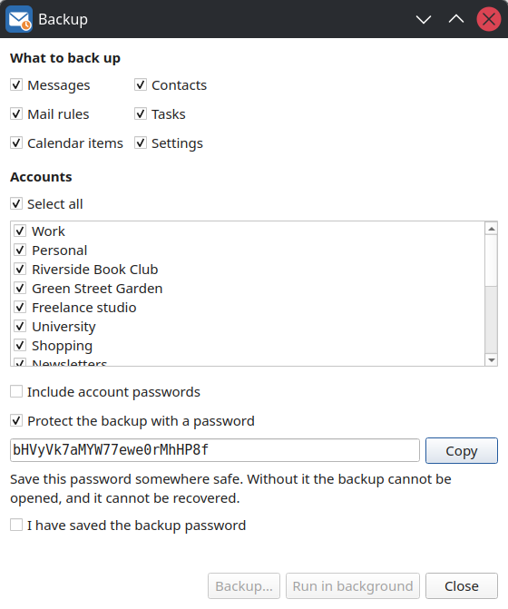
</picture>

Keep your backups away from this computer, for example on a USB stick or another computer. Mail kept only here, such as POP3 mail, exists nowhere else.

### Restoring a backup

1. Choose **Menu > File > Restore…**, or **Restore a backup…** in the Add an account window at the first start.
2. If you have not yet confirmed that this computer's recovery code is stored, Chrono Mail shows it first. That code is for this computer; the password of your backup comes in the next step.
3. Choose the .cmz file. For a protected backup, type its password.
4. In the **Restore** window, tick what to restore and which accounts, and if you like:
   1. **Account passwords** (only in a protected backup that has them).
   2. **Remove all data on this computer first**: everything here is replaced by the backup. Chrono Mail asks first. Nothing on your mail or calendar servers is touched, and if the restore does not finish, everything is put back as it was.
   3. **Replace items that already exist**.
5. Click **Restore…**.

<picture>
  <source media="(prefers-color-scheme: dark)" srcset="docs/images/restore-dark.png">
  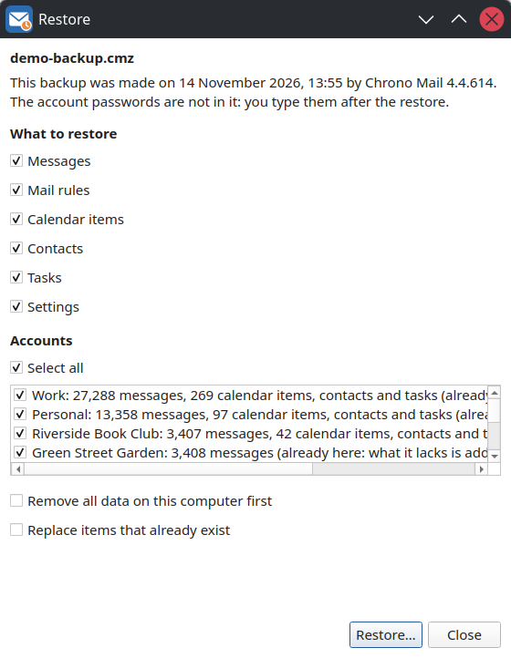
</picture>

After a restore everything is as the backup holds it, with three careful exceptions:

1. Nothing is sent by itself. Messages that waited in the Outbox come back in Drafts, and a scheduled message whose time has passed is paused. The report says so.
2. For IMAP accounts and calendars on a server, the server still decides: the next Refresh brings them in step.
3. Mail of a POP3 account that the backup left out is downloaded again rather than deleted on the server.

A damaged part of a backup is left out and reported; the rest comes back.

## Security and privacy

### Your mail is locked

Your messages, attachments, calendars, contacts and tasks are stored encrypted on your computer, with a key that is kept in your computer's password store. To list, sort and search your mail quickly, Chrono Mail also keeps a search index next to it, with things like senders, subjects and dates and a list of words for searching. That index is not encrypted; it can be rebuilt from your stored mail at any time.

### The key and the recovery code

1. **Menu > File > Show the recovery code…** (or **Settings > Security and storage > Show the recovery code…**) shows the code again, with **Copy** and **Save a recovery file…**.
2. **Menu > File > Use a recovery code…** (or **Settings > Security and storage > Restore the key…**) brings the key back with the code or a recovery file.

If the key is not in the password store when Chrono Mail starts, a window explains what happened (the key is missing, or the password store could not be opened) and offers:

1. **Restore with this code**: type or paste your recovery code.
2. **Use a recovery file…**: choose the file and type its passphrase.
3. **Try again**: for example after you unlocked the password store.
4. **Not now**: start anyway; the mail that needs the key cannot be read until you come back to this.
5. **Start without this mail**: only when Local Folders' key is gone and its recovery code is lost too. That mail is set aside, not deleted, and Chrono Mail starts without it; it cannot be opened without the key.

### Passwords

Passwords are kept only in your computer's password store, never in a file. They are never written to the log.

### Pictures, links and scripts

1. HTML mail is shown without scripts, and without pictures or other content from the internet until you allow it for that message or sender. See [HTML mail and pictures from the internet](#html-mail-and-pictures-from-the-internet).
2. Links show where they lead before you click, warn when they lead to another domain than the sender's, and ask before opening. See [Links](#links).
3. A file that would run a program is asked about first.

### Certificates

Chrono Mail checks the certificate of every server. When one cannot be checked, it asks you; it never accepts one by itself. See [Certificates](#certificates).

### Notifications

A notification of new mail shows only how many messages arrived, never who sent them or what they say.

### Updates

Chrono Mail never goes on the internet by itself just to look for updates. See [Updating](#updating).

## Settings

**Menu > Settings…** (Ctrl+,) opens one window with a list of pages on the left. Many changes show at once while you try them; **OK** keeps them and **Cancel** puts everything back. An option that cannot be used at that moment has an (i) after it: point at it, or click it, to read why.

### General

<picture>
  <source media="(prefers-color-scheme: dark)" srcset="docs/images/settings-general-dark.png">
  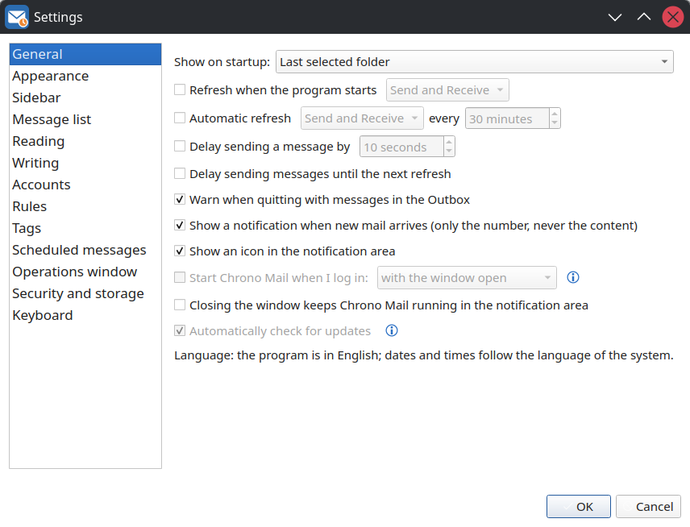
</picture>

1. **Show on startup:** what Chrono Mail shows when it starts: the last selected folder (the standard), a Favorites or Tags view, any folder, or a section.
2. **Refresh when the program starts**, with **Send and Receive**, **Receive only** or **Send only**.
3. **Automatic refresh**, with the same three choices, **every** so many minutes (30 at the start).
4. **Delay sending a message by** so many seconds, with **Send now** and **Cancel** while it waits.
5. **Delay sending messages until the next refresh**.
6. **Warn when quitting with messages in the Outbox**.
7. **Show a notification when new mail arrives (only the number, never the content)**.
8. **Show an icon in the notification area**.
9. **Start Chrono Mail when I log in:** **with the window open** or **with the window minimized**.
10. **Closing the window keeps Chrono Mail running in the notification area**.
11. **Automatically check for updates**.

If your desktop has no notification area, the notification and icon choices say so with an (i). When start at login or the update check cannot be used for this copy of Chrono Mail, they are greyed with an (i) that says why.

### Appearance

<picture>
  <source media="(prefers-color-scheme: dark)" srcset="docs/images/settings-appearance-dark.png">
  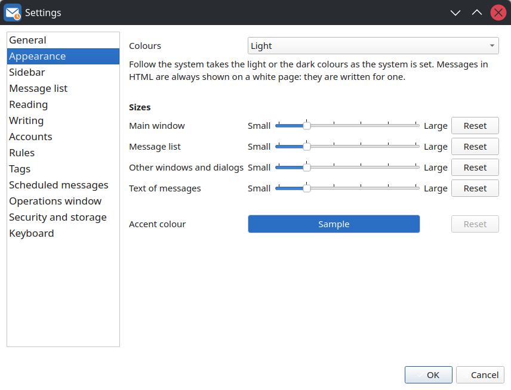
</picture>

1. **Colours**: **Follow the system**, **Light** or **Dark**.
2. **Sizes**: **Main window**, **Message list**, **Other windows and dialogs** and **Text of messages**, each a slider from **Small** to **Large** with **Reset**.
3. **Accent colour**: **Sample** opens the colour picker; **Reset** brings back the standard.

### Sidebar

**Show in the sidebar:**, with a tab per section: **Mail**, **Calendar**, **Contacts** and **Tasks**.

1. **Mail**: **Tags**, **Favorites** with each Favorites entry, **Local Folders** with its standard folders, and the accounts' own folder lists.
2. **Calendar**, **Contacts** and **Tasks**: **Tags**, and each calendar, address book or task list. One left out stays in step with its server, but is not shown and never offered for new items. The last one cannot be left out.

What **Show on startup** chose is always shown.

<picture>
  <source media="(prefers-color-scheme: dark)" srcset="docs/images/settings-sidebar-dark.png">
  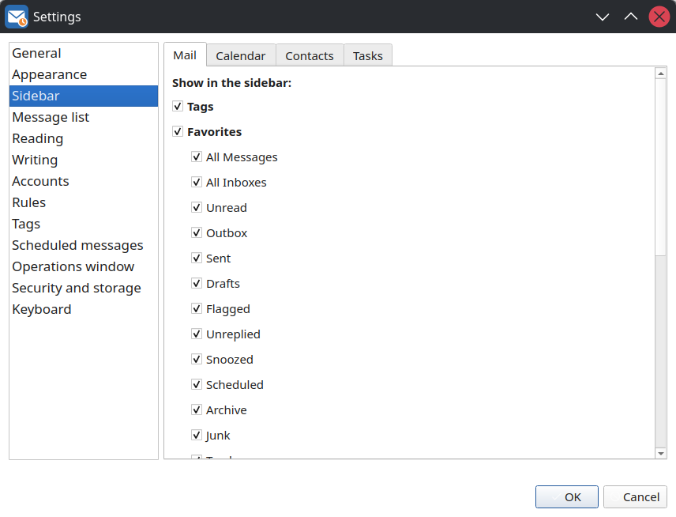
</picture>

### Message list

<picture>
  <source media="(prefers-color-scheme: dark)" srcset="docs/images/settings-message-list-dark.png">
  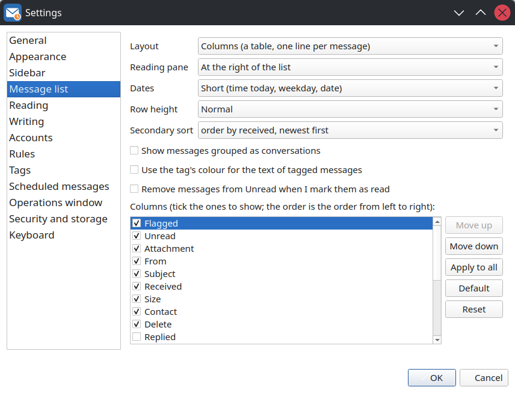
</picture>

1. **Layout**: **Columns (a table, one line per message)** or **Cards (sender, subject and a preview)**.
2. **Reading pane**: **At the right**, **At the bottom** or **Off**.
3. **Dates**: **Short (time today, weekday, date)**, **Date and time**, or the form 2026-10-11 09:30.
4. **Row height**: **Compact**, **Normal** or **Roomy**.
5. **Secondary sort**: messages with the same value **order by received, newest first** or **oldest first**.
6. **Show messages grouped as conversations**.
7. **Use the tag's colour for the text of tagged messages**.
8. **Remove messages from Unread when I mark them as read**.
9. **Columns (tick the ones to show; the order is the order from left to right):** with **Move up**, **Move down**, **Apply to all**, **Default** and **Reset**.

### Reading

<picture>
  <source media="(prefers-color-scheme: dark)" srcset="docs/images/settings-reading-dark.png">
  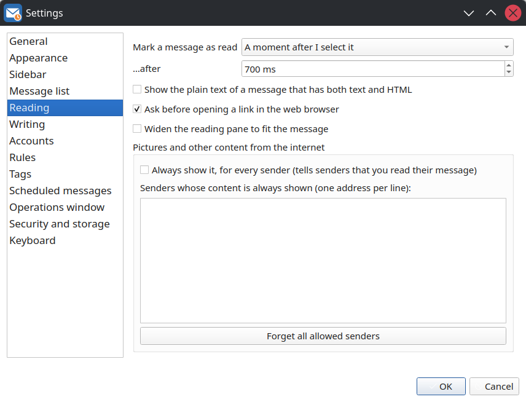
</picture>

1. **Mark a message as read**: **A moment after I select it** (**…after** so many milliseconds), **Only when I open it in a window of its own**, or **Never by itself (I mark messages)**.
2. **Show the plain text of a message that has both text and HTML**.
3. **Ask before opening a link in the web browser**.
4. **Widen the reading pane to fit the message**: off, the reading pane keeps the width you gave it.
5. **Pictures and other content from the internet**:
   1. **Always show it, for every sender (tells senders that you read their message)**.
   2. **Senders whose content is always shown (one address per line):**, a list you can edit.
   3. **Forget all allowed senders**.

### Writing

<picture>
  <source media="(prefers-color-scheme: dark)" srcset="docs/images/settings-writing-dark.png">
  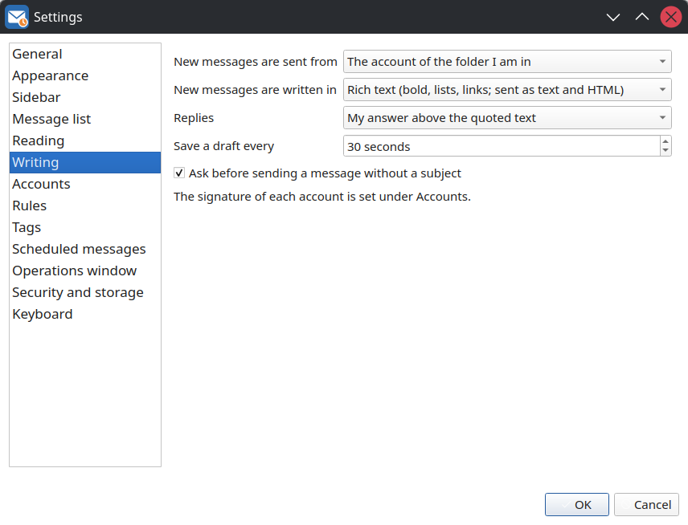
</picture>

1. **New messages are sent from**: **The account of the folder I am in**, or one account.
2. **New messages are written in**: **Rich text (bold, lists, links; sent as text and HTML)** or **Plain text**.
3. **Replies**: **My answer above the quoted text**, **My answer below the quoted text** or **Do not quote the original**.
4. **Save a draft every** so many seconds.
5. **Ask before sending a message without a subject**.

The signature of each account is set under Accounts.

### Accounts

Your accounts, with **Add…**, **Edit…** and **Remove…**. See [Accounts](#accounts).

<picture>
  <source media="(prefers-color-scheme: dark)" srcset="docs/images/settings-accounts-dark.png">
  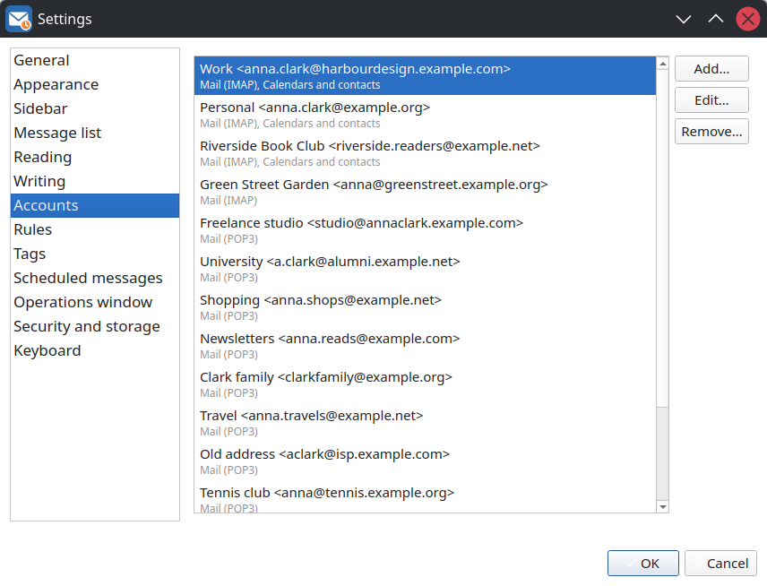
</picture>

### Rules

Your mail rules, with **New…**, **Edit…**, **Delete…**, **Move up**, **Move down** and **Apply to this folder**. See [Rules](#rules).

<picture>
  <source media="(prefers-color-scheme: dark)" srcset="docs/images/settings-rules-dark.png">
  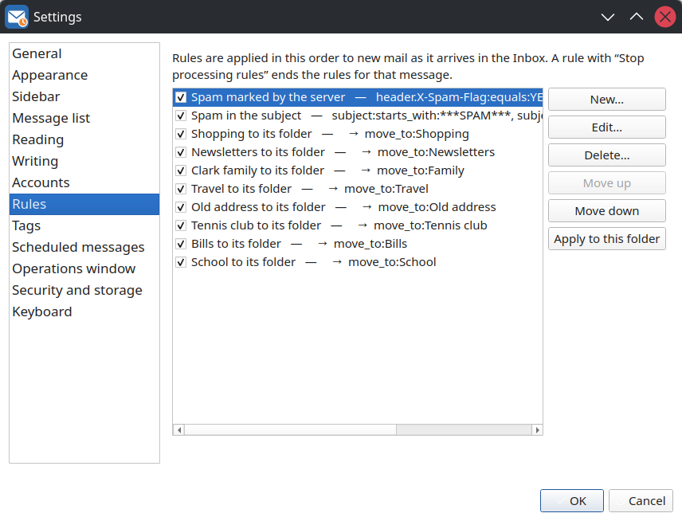
</picture>

### Tags

The one list of tags. See [Settings > Tags](#settings--tags).

### Scheduled messages

The messages waiting to be sent, and the snoozed ones. See [Settings > Scheduled messages](#settings--scheduled-messages).

### Operations window

<picture>
  <source media="(prefers-color-scheme: dark)" srcset="docs/images/settings-operations-dark.png">
  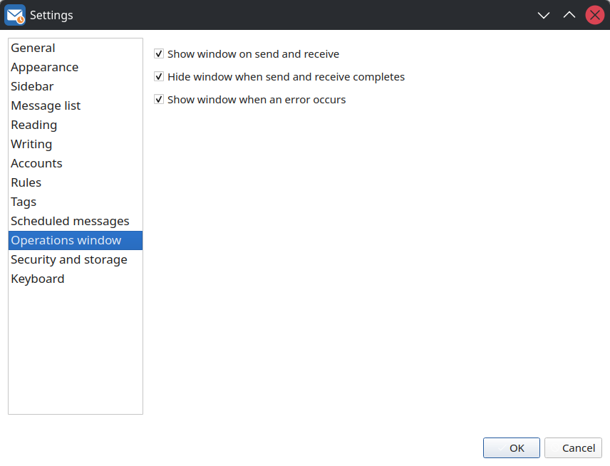
</picture>

1. **Show window on send and receive**.
2. **Hide window when send and receive completes**.
3. **Show window when an error occurs**.

All three are ticked at the start.

### Security and storage

<picture>
  <source media="(prefers-color-scheme: dark)" srcset="docs/images/settings-security-dark.png">
  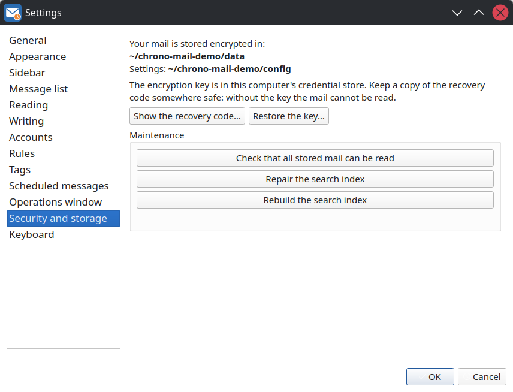
</picture>

1. **Your mail is stored encrypted in:** the folder where your mail is kept, and whether the key is in this computer's password store.
2. **Show the recovery code…** and **Restore the key…**.
3. **Maintenance**:
   1. **Check that all stored mail can be read**: reads every stored message and reports, per account, what it found.
   2. **Repair the search index**: brings the index in line with the stored mail.
   3. **Rebuild the search index**: makes the index anew. The window **Rebuilding the index** shows the progress, with **Run in background** and **Abort**. Your mail itself is not changed.

### Keyboard

Every action with its keys, in a table: **Action** and **Keys**. Click a key field and press the keys you want; Backspace or Delete empties it, and so does the ✕ in the field. A key that two actions would share is pointed out. **Standard keys** puts every key back as it was.

<picture>
  <source media="(prefers-color-scheme: dark)" srcset="docs/images/settings-keyboard-dark.png">
  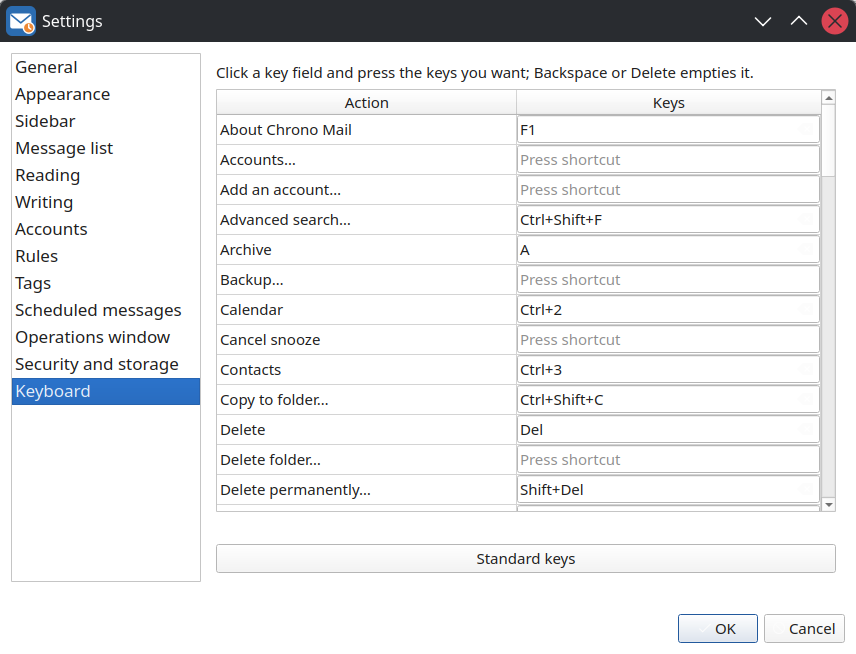
</picture>

## Keyboard shortcuts

These are the standard keys. You can change every key of the main window in **Settings > Keyboard**. A key works on the part of the window that has the keyboard: the single-letter keys, for example, work in the message list, not while you type in the search field.

### Everywhere

| Key | What it does |
|---|---|
| Ctrl+1, Ctrl+2, Ctrl+3, Ctrl+4 | Mail, Calendar, Contacts, Tasks |
| Ctrl+N | New: a message, event, contact or task, in the section on screen |
| F5 | Refresh (Send and Receive) |
| Ctrl+E | Go to the search field |
| Delete | Delete what is selected |
| Ctrl+, | Settings |
| Alt+M | Open the Menu |
| F1 | About Chrono Mail |

### Mail

| Key | What it does |
|---|---|
| Ctrl+R | Reply |
| Ctrl+Shift+R | Reply all |
| Ctrl+F | Forward |
| Enter | Open the message in a window of its own |
| Ctrl+Q | Mark as read |
| Ctrl+U | Mark as unread |
| R | Toggle read / unread |
| Insert | Toggle flag |
| A | Archive (or Unarchive) |
| S | Snooze… |
| Ctrl+J | Move to Junk; in Junk: Not junk (move to Inbox) |
| Shift+Delete | Delete permanently… |
| M | Quick move |
| Ctrl+Shift+V | Move to folder… |
| C | Quick copy |
| Ctrl+Shift+C | Copy to folder… |
| F | Next message |
| B | Previous message |
| N | Next unread message |
| P | Previous unread message |
| G | Go to folder… |
| Ctrl+Z | Undo |
| Ctrl+Y or Ctrl+Shift+Z | Redo |
| Ctrl+Shift+F | Advanced search… |
| Ctrl+Shift+S | Save as… |
| Ctrl+P | Print… |
| Ctrl+Alt+U | View source |
| F2 | Rename folder… |
| F9 | Show or hide the folder list |
| Ctrl+Alt+1 to Ctrl+Alt+9 | Give a tag, when that key is set for it in Settings > Tags |

### Writing a message

| Key | What it does |
|---|---|
| Ctrl+Enter | Send |
| Ctrl+S | Save draft |
| Esc | Close |
| Ctrl+B, Ctrl+I, Ctrl+U | Bold, italic, underline (rich text) |
| Ctrl+K | Make the selected text a link (rich text) |

### A message in its own window

| Key | What it does |
|---|---|
| Ctrl+R, Ctrl+Shift+R, Ctrl+F | Reply, Reply all, Forward |
| Esc | Close |

### Calendar

| Key | What it does |
|---|---|
| Enter | Open the selected appointment |
| F2 | Change the title of the selected appointment in place |

### In the search field

Type `?` alone to see the search words. In that list, the arrow keys move, Enter picks and Escape closes.

## Questions and problems

### My mail does not arrive

1. Press **Refresh** (F5), and look at the **Errors** tab of the Operations window (**Menu > View > Operations…**). It says per account what went wrong.
2. Check that the account is included: **Edit account > General > Include this account in Send and Receive**.
3. Check that **Automatic refresh** is on in **Settings > General**, or in **Menu > View > Refresh automatically**.
4. Look in **Junk**: the junk filter or the server may have put it there. **Not junk (move to Inbox)** brings it back, and teaches the filter.
5. Look at your **Rules**: one may have moved it to another folder. A search of **All folders** finds it wherever it is.
6. Open the account and click **Test connection** on the Servers tab.

### Gmail says my password is wrong

Gmail needs an app password, not your Google password. See [Gmail](#gmail).

### Chrono Mail asks about a certificate

A server's certificate could not be checked. Only choose **Connect** when you know the server is yours or your provider's. See [Certificates](#certificates). A message that waits because of this stays safely in the Outbox until it can go.

### A message stays in the Outbox

It goes with the next Refresh. If it keeps waiting, the status line and the Errors tab of the Operations window say why. You can also open it from the Outbox to change it.

### I sent a message too early

If **Delay sending a message by** is ticked in Settings > General, click **Cancel** on the notice at the bottom left while it counts down. Otherwise the message has gone; Undo cannot call it back.

### I deleted something by mistake

Press Ctrl+Z right away, or look in Trash and move it back. A message deleted for good (Delete permanently, or deleted from Trash) cannot be brought back. Undo works on mail only: a deleted contact, appointment or task cannot be brought back from within Chrono Mail. A backup (see Backup and restore) brings it back as it was then.

### My computer was reinstalled, and Chrono Mail cannot open my mail

The key that unlocks your mail was in the old password store. When Chrono Mail starts, it explains this and asks for your recovery code or recovery file. Type the code and choose **Restore with this code**. See [The key and the recovery code](#the-key-and-the-recovery-code). If only the password store was locked, unlock it and choose **Try again**.

### Chrono Mail shows a sync conflict

Something was changed both here and on the server, or the server refused a change. Nothing is lost: open **Menu > Sync conflicts…** and choose what you want to keep. See [When the server and Chrono Mail disagree](#when-the-server-and-chrono-mail-disagree).

### Pictures in a message are missing

They come from the internet and are not loaded until you allow it. Click **Show remote content**, or **Always for this sender**.

### I cannot find an invitation I declined

It is in its calendar, hidden. Click **Show declined** above the calendar.

### My new appointment went into the wrong calendar

New appointments go to the calendar with the blue plus. Right-click the calendar you want and choose **Use for new appointments**. To move one appointment, open it and choose another **Calendar**.

### I cannot delete or rename a folder

Inbox, Sent, Drafts, Trash, Junk, Archive, Outbox, Scheduled and Snoozed are standard folders: they cannot be deleted or renamed. Your own folders can.

### Search does not find a message I know is there

Check where the search looks (the button at the left of the search field) and whether a filter is on (the **Filter** button is blue). If it still is not found, **Settings > Security and storage > Repair the search index** puts the index right. Your mail itself is not changed.

### There is no icon in the notification area

Some desktops have no notification area. Settings > General then says so with an (i), and there are no icon and no notifications.

### Reminders did not come

Chrono Mail gives reminders while it is running. Tick **Closing the window keeps Chrono Mail running in the notification area** and **Start Chrono Mail when I log in** in Settings > General, so that it runs whenever you are logged in.

## Help and feedback

Found a problem, or missing something? Tell us on the [issues page](https://github.com/rob-vandenberg/chrono-mail/issues).

## For developers

See [`CONTRIBUTING.md`](CONTRIBUTING.md).

## License

Chrono Mail is free software under the GNU Affero General Public License v3.0. See [`LICENSE`](LICENSE).
